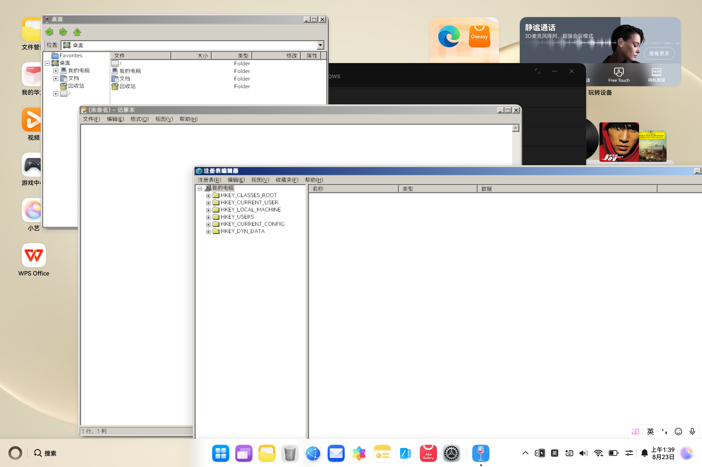

# VintagePomeloPro — Windows games on HarmonyOS

2.0.0 主线在 HarmonyOS (OpenHarmony) ARM64 设备上使用原生 ARM64 OHOS Wine、FEX 和 HmosDeck，运行 Windows Steam 与 Windows x86/x86_64 程序。
FEX 为默认转译器，Box64 保留为 WOW64 兼容选项。Linux Steam、GNU Proton 运行载荷和相关产品界面已退出本产品路线。

GitHub 默认分支为 `main`。2.0.0 冻结标签为 `rc-2.0.0`；后续完整上游同步在 `feature/fex-proton-upstream-sync` 推进，
见 [FEX / Proton 同步计划](docs/upstream-sync/plan.zh-CN.md)。



## 架构

```
HmosDeck / Windows Steam / Windows PE (x86 / x86_64)
    ↓ 原生 ARM64 OHOS Wine
    ├── FEX WOW64 / ARM64EC 转译 Windows 客体代码（默认）
    ├── Box64 WOW64 兼容选择
    └── winewayland.drv / wineohos.drv
           ↓
ARM64 原生窗口、图形、输入和音频宿主
    ├── Wayland compositor / 窗口生命周期
    ├── InputManager（鼠标、键盘、触摸）
    ├── EglRenderer / GraphicsBroker（沿用已适配呈现与图形接口）
    └── AudioBroker（OHAudio 宿主音频）
```

ARM64 主线执行原生 ARM64 Wine Unix 层，FEX 的 `libarm64ecfex.dll` 与 `libwow64fex.dll` 分别提供对应转译入口。
Box64 兼容项通过 `wowbox64.dll` 接入 WOW64；它不表示默认仍运行旧的 x86_64 Wine ELF 方案。
x86_64 构建目标与旧路线资料按各自范围保留，不能作为当前 ARM64 主线的构建说明。

## 当前状态

| 功能 | 状态 |
|------|------|
| ARM64 原生 OHOS Wine + 默认 FEX | 当前主线 |
| Box64 WOW64 兼容选择 | 保留 |
| Windows Steam / HmosDeck | 保留；Steam UI 仍有待优化的卡顿 |
| Linux Steam / GNU Proton 产品载荷 | 2.0.0 已移除 |
| Explorer 桌面 | ✅ |
| 多窗口 | ✅ |
| 鼠标 / 键盘输入 | ✅ |
| 音频 (WASAPI / DSound / waveOut / MCI / MIDI) | ✅ |
| VirGL / OpenGL (guest Mesa virpipe) | ✅ |
| NAPI 沙箱运行 | ✅ |

## 构建

```bash
# 完整构建
make NATIVE_ARCH=arm64-v8a

# CI 同一路径：从锁定源码构建未签名 HAP
make NATIVE_ARCH=arm64-v8a hap-unsigned

# 已有匹配原生组件时，重新组装 HAP
make NATIVE_ARCH=arm64-v8a hap

# 固定构建环境、依赖准备与发布检查: .github/workflows/build.yml
```

现行构建与打包以 [Makefile](Makefile)、[scripts/package.sh](scripts/package.sh) 和
[CI 工作流](.github/workflows/build.yml) 为准。[原构建指南](docs/BUILD_GUIDE.md) 保留早期方案与环境搭建资料。

## 目录结构

```
VintagePomeloPro/
├── entry/src/main/
│   ├── cpp/                   # Native C++: Wayland compositor, EGL, Input, Audio
│   │   ├── napi_init.cpp      # NAPI 桥接 + wine/wineserver/broker 进程管理
│   │   ├── wine_child.cpp     # NCP 子进程入口 (Main/WineserverMain/MmapTestMain)
│   │   ├── virgl_child.cpp    # VirGL NCP 子进程入口
│   │   ├── wayland_server.cpp # 嵌入式 Wayland compositor
│   │   ├── egl_renderer.cpp   # EGL/GLES 渲染器 (Native VSync)
│   │   ├── input_manager.cpp  # 鼠标/键盘事件注入
│   │   ├── broker.cpp         # Broker 中继 (CreateProcess → NCP)
│   │   ├── graphics_broker.cpp # VirGL 后端管理
│   │   ├── audio_broker.cpp   # Host-broker 音频引擎
│   │   ├── wine_env.cpp       # 环境变量构建
│   │   ├── wine_launch.cpp    # 启动流程 (wineserver → wineboot → explorer)
│   │   └── xdg_shell.cpp      # xdg-shell 协议实现
│   ├── ets/pages/
│   │   ├── Index.ets          # 主界面 (侧边栏 + 桌面)
│   │   ├── WineWindow.ets     # Wine 子窗口
│   │   └── DesktopWindow.ets  # 桌面窗口
│   ├── ets/model/AppModels.ets          # 配置与 CPU 转译选择
│   ├── ets/service/WineWindowManager.ets # 窗口生命周期
│   └── ets/steam/SteamLocalService.ets  # Windows Steam
├── scripts/
│   ├── env.sh                 # 环境变量 (NATIVE_ARCH, 工具链)
│   ├── build_wine.sh          # Wine 构建
│   ├── build_fex.sh           # FEX ARM64EC / WOW64 构建
│   ├── build_box64_wow64.sh   # Box64 WOW64 兼容组件
│   ├── build_guest_gfx.sh     # Guest Mesa (VirGL) 构建
│   ├── assemble.sh            # rawfile zip + libs/ 布局
│   └── check-submodules.sh    # Submodule 状态检查
├── docs/                      # 详细文档
│   ├── CURRENT_STATUS.md      # 当前状态 & 修复清单
│   ├── ARCHITECTURE.md        # 架构详解
│   ├── BUILD_GUIDE.md         # 构建指南
│   └── README.md              # 文档索引
├── .claude/rules/
│   ├── build-and-log.md       # 构建命令与日志速查
│   └── submodule-workflow.md  # Submodule 管理方案
└── thirdparty/                # git submodule
    ├── wine-valve/            # OHOS 适配的 Valve Wine fork
    ├── fex/                   # 锁定的 FEX 源码
    ├── box64/                 # winehua/box64
    ├── mesa/                  # winehua/mesa-ohos
    ├── virglrenderer/         # winehua/virglrenderer
    ├── libepoxy/              # winehua/libepoxy
    ├── freetype/
    ├── wayland/
    └── xkeyboard-config/
```

## 关键适配

- **OHOS Wine / FEX**: 原生 ARM64 Wine 配合 ARM64EC / WOW64 转译，FEX 默认，Box64 为 WOW64 兼容选择
- **Windows Steam**: 保留游戏库、启动、受管运行时升级和离线导入；离线包锁见 [固定清单](docs/windows-steam/offline-package.lock.json)
- **Wayland compositor**: HAP 进程内嵌入式 compositor，不依赖外部 Wayland 服务
- **NCP appspawn**: 通过 `OH_Ability_StartNativeChildProcess` 创建子进程
- **Broker**: 中继 Wine 内部 CreateProcess → NCP，转发环境变量和 fd
- **VirGL**: guest Mesa virpipe → vtest socket → virglrenderer → host EGL
- **Audio Host Broker**: 宿主进程集中持有 OHAudio，Wine 侧通过 IPC + ring buffer 传输 PCM
- **surfaceId 架构**: 通过 `XComponentController` 回调获取 surfaceId，解决多窗口冲突
- **noexec 文件系统**: 可执行段用匿名 mmap + pread 替代文件映射
- **dosdevices symlink**: OHOS 沙箱禁止 symlink()，fallback 到 drive_c
- **XKB 键盘**: xkeyboard-config 打包到 rawfile，通过 `XKB_CONFIG_ROOT` 指向

## 日志

Wine 输出（stdout + stderr）重定向到 hilog + 文件：

```bash
hdc -t <device_ip> hilog | grep -E 'WL_NAPI|WL_EGL|WL_Server|WL_Input|GraphicsBroker|WineChild'
```

## 交流

QQ 群：**966307250**（Vintage Pomelo Team）


## 上游项目

本工程基于 [winehua/WineHua](https://github.com/winehua/WineHua/)（Run Windows exe on HarmonyOS based on box64 and Wine）开发。


## 许可证

本工程保留 WineHua 上游已有的 [LGPL-2.1-or-later 授权](LICENSE)。第三方代码、字体、音色库及外部软件按各自许可处理，不由根目录许可证统一重新授权。

- [许可范围与分发检查清单](LICENSING.md)
- [依赖版本、许可及待核实项](THIRD_PARTY_NOTICES.md)
- [已核实的上游许可原文与来源校验](licenses/README.md)

这些文档不代表当前 HAP 已完成许可合规验收；音色库授权、实际二进制依赖及随包声明/对应源码仍须按分发清单核实。
