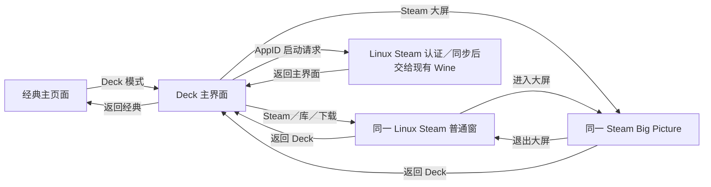

# 经典／Deck 双界面与 Linux Steam 产品设计

2026-10-20。本文件保留完整产品目标；当前已实现经典／Deck 切换、ArkUI 石墨主题与封面动画、Linux 安装清单／封面缓存、单一 Steam 会话控制及已有窗口恢复。联网首次安装／独立更新仍待正式发布源、签名索引和版本配对，不能视为已交付。最新结果见 [Deck UI 平板验收](DECK_UI_TABLET_20261020.zh-CN.md)，此前窗口／输入结果见 [窗口报告](TABLET_WINDOW_20261020.zh-CN.md)。

## 产品决定

保留经典 UI，新增专用 **Deck 模式**；旧 ArkTS Steam 账号登录、Guard 令牌、独立游戏库排列与内容下载页面退出 Linux 分支的产品路径。Steam 账号只在官方 Linux ARM64 Steam 登录一次，认证、商店、游戏下载、更新与云存档都由该客户端负责。

Deck 主界面按 DroidDeck 的组织方式用 ArkUI 实现：最近游戏、封面／hero、已安装库、运行中、下载／Steam 与设置。它是应用主界面；官方 Steam Big Picture 是其中可打开的 Steam 大屏页面。两者分别显示为“Deck 模式”和“Steam 大屏”，避免把退出 Steam 大屏误当成切回经典 UI。旧 ArkTS 登录／库页不作为新 Deck 首页的数据或账号来源。

用户日常只遇到一个 Linux Steam 安装、一份账号状态和一个游戏库。经典界面可以继续使用既有 Windows 程序、文件管理、会员和设置。切入 Deck 无需先下载 Steam；资源未安装时显示安装入口，本地已有的非 Steam 游戏仍可启动。

## 页面与切换

| 所在位置 | 主要入口 | 行为 |
| --- | --- | --- |
| 经典主页面 | 顶栏常驻“Deck 模式”按钮 | 即时进入 Deck 主界面；无需绕到设置，无需重启应用 |
| Deck 主页面 | 左侧常驻“经典界面” | 回到原经典页的分类、搜索、滚动位置和选中项 |
| Deck 主页面 | 最近游戏／已安装／运行中 | 有真实本地数据才展示游戏，游戏详情内复用已有兼容配置 |
| Deck 顶栏 | Steam／下载 | 同一 Linux 客户端中的库或下载页；未安装时进入统一安装页 |
| Deck 主页面 | “Steam 大屏” | 在同一会话中进入官方 Big Picture；不再启动另一个客户端 |
| Steam 大屏退出 | 官方“退出大屏幕模式” | 返回该会话的普通 Steam 窗口，应用界面仍保持 Deck；“返回 Deck”恢复应用主屏 |
| 统一设置 | 界面：经典／Deck | 与主页面快捷按钮同步；保存下次启动默认界面 |

“返回经典”和“返回 Deck”属于应用导航；Steam 的“桌面／大屏”属于客户端展示方式。应用内快捷工具栏与既有任务栏提供返回当前主界面的操作，不增加新的任务浮窗。切回主界面不退出 Steam、不结束游戏；运行中入口始终能恢复游戏或 Steam。切换 UI 不触发云同步或修改游戏分辨率。

快捷切换先保存页面状态、释放所有按下键与鼠标／手柄状态，再交接焦点。输入只由当前前台的 ArkUI、Steam 或游戏一方消费。双向切换幂等，连续点击不创建第二会话。游戏前台可通过既有设置入口切主界面；不强制结束正在玩的游戏。



## Deck 主界面

当前视觉：左侧窄导航含 Steam、游戏库、运行中、下载、组件、设置与经典界面；首页左下 HMOSDeck 字标和蓝色启动按钮，右侧根据安装游戏数量展示扇形封面或倾斜封面墙。安装库使用独立封面网格；Steam 选项面板含客户端、显示与动画、系统三个标签。底部显示确认／返回提示。外观以深色背景、渐变、焦点放大与明确主按钮为主，复用现有会员和系统设置；不沿用旧的 ArkTS Steam 登录页。

游戏库分为 Steam 游戏、内建工具、本地游戏三个标签，搜索限定当前分类。本地游戏沿用经典目录中的条目、启动与设置；已有自定义封面优先，其次复用已有背景，内建工具使用原资源。三类均为同样的卡片，保留来源标记；卡片随列宽保持 2:3，图片按原始比例完整显示，不以固定解码宽高拉伸横图。

卡片点击先显示带封面、名称和阶段文字的启动提示，再让出渲染时机后调用原启动流程。Steam 冷启动分别记录组件准备、Wine 桌面、窗口宿主、原生客户端就绪、命令派发和窗口恢复的耗时，反馈期间阻止重复启动。提示只表示正在准备，不将 URI ACK 或窗口出现当作游戏认证／可玩已通过。

平板宽屏采用 hero + 横向封面 + 库；窄窗／手机减少列数，避免挤出可操作区域。按可用 vp 排版，游戏分辨率、Steam 的 X11 渲染尺寸和 ArkUI 布局分开。经典视图保留原布局，切换后恢复其上下文；Deck 也记住上次选中的卡片与页面。

首页先展示本地已安装 Steam 游戏和显式添加的非 Steam 游戏。后者带来源标识，仍由原 Wine 启动。未安装但已拥有的完整库先打开真实 Steam 库；新增已认证目录接口前，不从封面文件或旧 ArkTS 登录缓存推断所有权。Steam 游戏从 Deck 启动只传 AppID，依次经过真实 Steam 的许可、安装／更新、启动前同步、注册兼容工具、OHOS Wine／FEX／DXVK；不直接执行其 EXE。

## 首次安装：用户只点一次“安装 Steam”

点击 Steam 相关操作时，由 `LinuxSteamInstallService.ensureReady()` 检查设备能力、目录、资源版本及宿主 ABI。缺失时显示一个安装页：用途、将下载大小、所需剩余空间、默认存储位置与“安装 Steam”。大小由发布清单计算，不能写死当前研究包大小。

下载安装分为两个来源，由同一进度展示：

1. **HmosDeck GNU 运行组件**：从项目维护的静态发布源取得配套 ARM64 loader／glibc、Xwayland、GNU Mesa、字体／语言数据和自有桥。可采用对象存储／CDN 或版本化 Release，不需要另建常驻业务服务器；必须先发布可访问的实际文件和签名索引。
2. **官方 Steam 客户端**：从 Valve 官方 `https://client-update.steamstatic.com/` 的 Linux ARM64 更新包取得 ELF、CEF 与资源；复用现有 package lock／SHA-256 验证和提取规则。不要求用户自己找 ZIP，不让 Windows Steam 与 Linux Steam 混在同一目录，也不把 Valve 资源塞进 HAP。

项目发布索引记录稳定通道、GNU runtime ID、bridge ABI、最低宿主版本、支持的客户端 build、官方下载包名称／大小／hash 和解包大小。HAP 固定发布源与索引验签公钥；URL 和 key 属于发布配置，不用当前电脑或设备的路径。下载和校验的状态可以复用，用户中断后从已验证分块续传；服务器不支持 Range 时只重下对应未完成包，不重新下载全部资源。

安装状态：`未安装 → 下载中 → 校验中 → 安装中 → 就绪`，并有暂停、可恢复失败和空间不足。错误页明确失败阶段、简洁原因、重试／继续及返回经典；按钮始终可操作，不能再出现无说明的灰按钮。安装成功后打开官方 Steam 登录界面，不新增 ArkTS 账号、密码、二维码或令牌输入。

首次权限只处理真实需要的资源目录选择／授权；已有有效目录直接复用，不反复让用户选目录。下载任务和断点信息持久化，进程结束后重启可恢复。是否能在后台持续下载取决于已验证的 HarmonyOS 任务能力；能力未验收前显示“暂停，重新打开可继续”，不能只靠页面定时器承诺后台完成。

## 外置资源与单一游戏库

沿用 `Z:\SteamLinuxARM64`，正常流程隐藏内部版本目录。首页显示人能理解的“Steam 已就绪／需要安装／可更新”；高级设置可查看路径和版本。

```text
SteamLinuxARM64/
  active-deployment.json       # 一次原子提交：runtime + client + ABI
  releases/<runtime-id>/      # 已校验 GNU 组件，不混入用户数据
  client-releases/<build-id>/  # 已校验客户端代码与网页资源
  client/                     # 稳定的 Steam home、账号及可写客户端状态
  library/steamapps/          # 唯一可见 Steam 游戏库、下载和安装清单
  staging/                    # 未完成的新安装／更新
  downloads/                  # 有界、可清理的包与续传记录
```

这是目标布局，当前实验包中的客户端 ELF 与 runtime 同一 release，不能只改目录名就实现分离。需先把 `LinuxSteamDiagnosticData` 的路径解析抽出，区分 GNU 搜索路径、客户端代码根、可写 Steam home、游戏库和临时目录；保持 GNU 路径别名、launch broker、Cloud 路径与 SteamAPI 对同一部署快照一致。现有已安装资源通过清单识别并复用；迁移使用事务，不重复复制完整游戏或重新登录。

存档、账号与游戏均不放进可回收版本目录，更新、修复和返回经典不得删除它们。用户界面只显示一个 Steam 安装位置和一份游戏库。首次安装、升级或迁移期间不会弹出 Windows 客户端导入入口。高级“从本地资源恢复”可以保留在维护页，不能作为普通安装前提。

## 更新策略

用户只见“Steam 有更新 → 下载更新 → 下次启动应用”。内部区分 HAP、GNU runtime 与 Steam client，避免一次客户端更新就重装整个应用。

| 更新类型 | 下载与应用 | 回退边界 |
| --- | --- | --- |
| HAP／宿主 | 原应用更新渠道 | 涉及 NAPI／桥 ABI、权限或原生接收端变化时，明确要求先更新应用 |
| GNU runtime／桥组件 | 项目稳定发布源，按文件 hash 复用未变化项 | 保留当前与上一个可用部署；loader／glibc 成对，不能混搭 |
| 官方 Steam／CEF | 官方包成套取得，匹配已验证 runtime 与桥 ABI | 客户端代码与 steamclient／helper／资源一同切换，不单换一个 DLL／SO |
| 游戏更新 | 真实 Linux Steam | 状态、取消与修复由客户端负责，Deck 只显示可靠结果 |

默认启动时每天至多检查一次小型发布索引；设置页支持主动检查，网络失败不阻断已安装的可用版本。更新可下载到 staging，Steam／游戏运行时不切 active；等真实会话全部退出后，校验、预检再原子提交新的部署。升级断电／中断仍能启动旧版本。首轮健康检查失败时恢复旧部署，保留失败诊断；账号数据库、用户设置和 Cloud 数据不自动回滚，若新版已迁移不可逆数据则停止自动降级并给出修复入口。

不能假定现有 Steam 原生自更新器已经可用。目前启动使用外置映射，更新器若写入另一目录或产出不同架构，会与 active hash／GNU bridge 不一致。第一阶段由部署管理器统一接管官方代码包；实际验证并协调 Steam 更新请求和启动脚本的自更新行为。需要强制新客户端而稳定通道尚未验证时显示“需要更新兼容组件”，不静默忽略强制更新或伪造当前版本。后续即使允许官方自更新，也必须在独立 client staging 中完成并经过一致性验证，不能让两个更新器并发写 live 目录。

修复功能重新校验并仅补齐资源文件，不清用户数据。清理只回收未引用的旧 runtime／client 与已完成缓存，保留活动、回退和运行中引用的版本。空间计算需包括压缩包、解包、staging 和必要回退，不能只检查下载文件大小。

## 服务拆分与旧入口处理

| 模块 | 处理 |
| --- | --- |
| `Index.ets`／`ThemeSettingsService` | 挂载经典／新 Deck 根视图及快捷切换；主题变化不拥有或销毁 Steam 会话 |
| `UiSkin`／`AppSettingsStore` | 增加稳定 Deck 值；Linux 分支加载旧 `console` 值时归一到 Deck，两项选择仅经典／Deck；保留旧设置字段以便回退读取 |
| `SteamAccount.ets`／旧 `SteamGameDetail` 路由 | 从 Linux 分支主导航移出；旧深链重定向实际 Linux Steam，资源缺失则进入安装页 |
| `Index` 的旧 Steam 登录初始化、CM 恢复、Guard timer、旧库轮询 | 不再随主页面启动；防止界面虽隐藏、后台仍连接旧 ArkTS 会话 |
| `SteamClientPanel`／Windows `SteamLocalService` | 新 Linux Steam 入口不再调用其 Windows ZIP 导入与客户端卡片；已有用户 Windows 文件不自动删，普通手动添加程序仍可留在经典库 |
| `LinuxSteamInstallService`／`LinuxSteamUpdateService`／`LinuxSteamDeploymentStore` | 新增。负责正式发布索引、续传、校验、事务激活、版本配对与回退 |
| `LinuxSteamSessionService` | 从 SmokeRunner 抽出正式生命周期；单例／互斥启动、真实 READY、结构化请求／ACK／generation、正常退出；无测试 Want／四小时诊断时限 |
| `LinuxSteamLibraryService`／新 Deck 组件 | 只读 Linux 清单和缓存，区分非 Steam 卡片；不依赖旧 ArkTS token／CM 连接 |
| `LinuxSteamWindowHost`／现有任务与输入服务 | 复用已有 Wine HWND、窗口恢复和焦点规则；桌面↔大屏统一由真实客户端确认 |

新登录态从实际 Linux Steam 会话取得，旧 ArkTS token／Guard 不导入或冒充同一会话；旧凭据在升级时不擅自删除，在设置提供明确的旧数据清理。账号切换使库缓存失效，仍只在真实 Steam 里办理。Windows 同步分支维持自己的产品行为，这份迁移仅面向 `main_proton_steamarm64`。

状态必须拆开：`launcherMode = classic | deck`、`steamPresentation = desktop | bigPicture`、`installState`、`sessionState`、`cloudState`。UI 切换完成不等于 Steam 就绪，进程存在不等于登录成功；游戏正常退出也不等于云同步成功。Steam 控制命令沿用 requestId／generation／ACK，只接受固定 action 和 AppID，不接收任意 shell。

## 实施与验收顺序

1. **部署与会话基础**：发布实际运行组件、官方包锁及签名索引；提取正式会话服务，完成干净设备一键安装、原生登录、停止／恢复和更新回退。不先删除旧入口，待替代链路具备可用错误提示后统一切换。
2. **经典入口收敛**：经典页新增 Deck 快捷按钮与唯一 Linux Steam 安装／打开入口；移出旧登录／库流程与后台初始化，确认非 Steam 程序和会员流程正常。
3. **Deck 首页**：hero、最近与已安装封面、运行中、设置和返回经典；连接真实目录及 AppID 启动。实现焦点恢复和方向键／手柄导航。
4. **大屏与完整往返**：Deck→官方 Steam 登录／下载／大屏→游戏→同步→Deck→经典；平板、手机分别验收，手机游戏启动遗留故障单独追踪。

验收至少包含：无资源时无需 HDC／手动 ZIP 即可安装；网络中断与重启续传；空间不足／损坏包明确提示；Steam 运行中更新不会替换 live 文件；配套更新失败能回到旧部署且存档不丢；已有安装升级不重复下载游戏；同账号一套登录态和一个库；经典↔Deck 连续切换不重启／重复启动 Steam；官方大屏退出恢复原窗口而不是改应用主题；Steam／游戏最小化仍能找回；触摸、双指滚动、键盘、手柄焦点不串场；会员、客服、设置在两种界面可达。

## 当前待补齐的发布项

GNU 运行组件的正式静态发布地址、签名索引／密钥、首个稳定 runtime／client 配对及原生自更新协调仍待实现和部署。现有 HDC external-import 是开发验证链路，不能对用户宣称已经支持联网一键安装。本轮不发布远端文件、不修改用户登录及游戏数据。

研究依据和依赖详见 [DroidDeck 源码调研](DROIDDECK_UI_RESEARCH.zh-CN.md)、[第三方清单](THIRD_PARTY_RUNTIME.zh-CN.md)。交互原型见同目录 `deck-product-prototype.html`，其中安装／登录／启动为显式模拟，用于确认流程。

原型已在浏览器完成经典／Deck 往返、缺资源安装、暂停续传、登录占位、官方大屏退出独立于应用主题、窄布局和游戏运行中延迟更新等流程检查，无脚本异常。此结果只验证交互原型，不代表正式下载、账号登录或设备更新验收。
