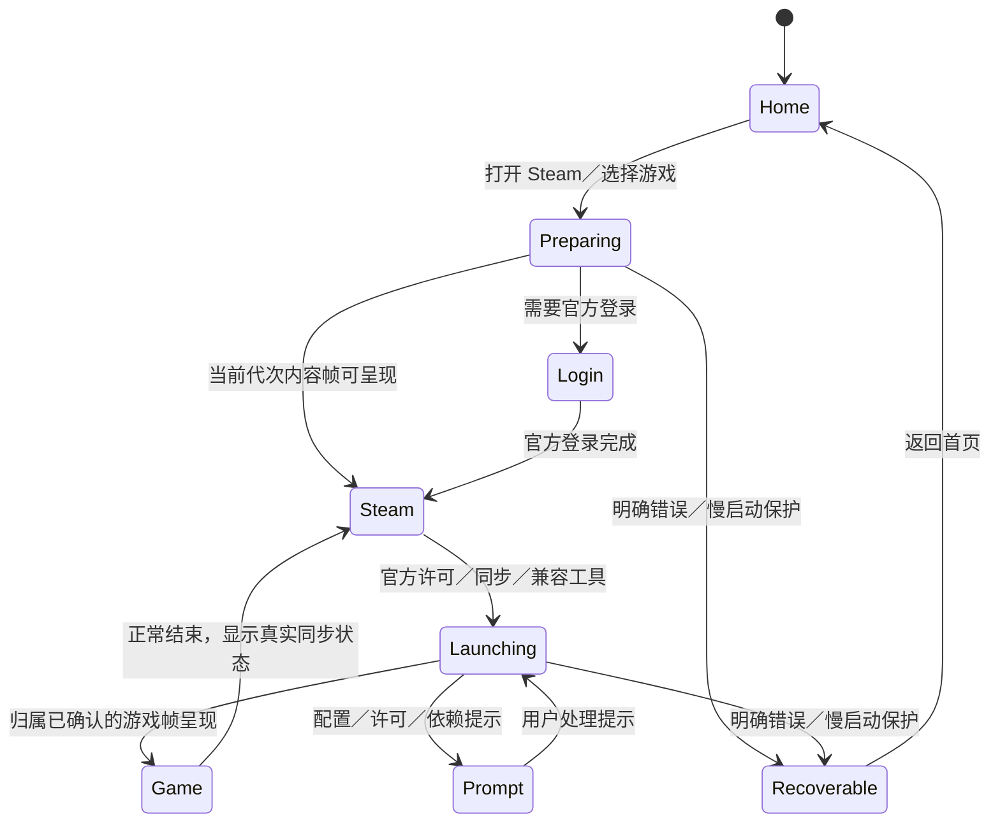

# HmosDeck：以 Linux Steam 大屏为中心的会话体验

2026-10-26。设计基线为 `main_proton_steamarm64` 的 `5e8992c8`。本文包含后续设计及文末列出的已实现增量；配套 [可点击原型](deck-product-prototype.html) 中的客户端、购买、安装和启动均为模拟，不代表真机验收。默认主题、游戏库及用户保存的兼容工具选择沿用原策略。

本文更新旧 [经典／Deck 产品设计](DECK_PRODUCT_DESIGN.zh-CN.md) 的默认显示、启动、游戏呈现和退出策略。旧文中的安装／分发状态是历史记录，不能用作当前发布状态判断。

## 1. 产品决定

让用户从「选择游戏」连续进入「游玩」，收起中间的空桌面、居中黑窗、终端和诊断控件。ArkUI Deck 保留快速启动、本地游戏和设备设置；Steam 登录、完整游戏库、商店、结账、下载及云同步使用同一个官方 Linux ARM64 客户端。进入 Steam 后默认展示官方 Big Picture，不再叠加第二套 Steam 导航栏。

应用主题和 Steam 模式分别保存。首次启动应用仍使用经典主题；用户切为 Deck 后下次沿用。首次打开 Linux Steam 使用大屏；用户明确改为普通窗口后保存选择。升级不覆盖已经保存的普通窗口偏好。大屏退出到普通窗口属于 Steam 内部切换，不改变应用主题。

用户的「启动直接居中黑屏」按当前启动缺陷处理：提供占满当前应用内容区的启动过渡，并在真实帧可呈现后交接。手机／平板运行页进入横屏沉浸布局，返回首页恢复原方向策略。鸿蒙 PC 先铺满应用窗口；用户显式选择系统全屏后才扩大到整个显示器，避免占用另一显示器或越过宿主窗口。

## 2. 已确认的基础与缺口

| 当前源码事实 | 本轮设计的增量 |
| --- | --- |
| `LinuxSteamSessionService` 先准备 Wine 桌面、创建宿主窗，再启动 GNU Steam；启动期 presentation 固定为 desktop | 启动意图与实际模式分开；过渡画面贯穿各阶段，初始目标默认 bigPicture |
| `LinuxSteamWindowHost` 仍启动 `hmosdeck-steam.exe`，等待宿主几何后绑定 Xwayland | GNU Proton 已可独立执行游戏，但 Steam 展示仍有 OHOS Wine 宿主依赖。第一阶段保留稳定桥，后续抽成可替换呈现适配器 |
| 当前 Ready 表示 Steam surface 就绪，不等于账号、许可、游戏就绪；90 秒等待结束后 worker 可继续 | 增加首帧／窗口代次证据、分阶段进度和有界慢启动反馈；不能把进程存在、URI ACK 当作可玩 |
| HostWindowTasks 已维护窗口身份、前台修订号、启动意图和会话 | 扩展为两个后端共用的窗口角色／归属和呈现策略；修复 GNU 新窗口仅按出现时间归属的薄弱点 |
| 已有大屏退出后的页面恢复，且限制在前台 Steam 操作 | 保留该保护。游戏运行、支付验证或用户已返回首页时，不自动抢焦点、导航或重启 |
| CEF 默认软件路径；手机此前启用 GPU 出现缺字 | 界面优化沿用已验证路径。CEF GPU、游戏 GPU 和全屏呈现分别验收，不随 UI 改动启用强制 GPU |

上述是静态代码核对，不能据此断言黑屏唯一根因或新体验已经稳定。

## 3. 导航和视觉

### 主界面

Deck 使用石墨黑 `#0A0B0D`、分层表面 `#121417 / #1A1D22`、Steam 蓝 `#1A9FFF`，保留已有扇形封面／封面墙。减少首页常驻按钮：侧栏只保留首页、游戏库、Steam、设置；运行中的游戏作为首页首个「继续游戏」区域，下载状态在 Steam 入口显示。组件维护放进设置，不再出现首页、抽屉和组件页的三套相同入口。

游戏库继续分 Steam、本地游戏、内建工具，封面保持原比例。缺图显示名称和来源，不拉伸横图填竖封面。会员与赞助仅在支持设备的侧栏／设置可达，手机类型不显示相关功能，也不在 Steam 商店中混入应用会员购买。

Steam 内容页保留 Steam 自身布局与菜单；全屏不加外层标题栏。普通模式保留 Steam 自身窗口按钮及可拖边框。现有工具栏收起成一个可唤出的系统菜单入口，不另建运行任务浮窗。诊断详情只在设置／错误页按需展开。

### 动画与输入

- 点击后首个 UI 更新即显示游戏封面或 HMOSDeck 启动画面，然后异步准备；目标反馈小于 100ms，属于验收目标。
- 焦点放大约 1.03 倍，按下约 0.98 倍；启动交接淡入约 160–220ms。无每帧 JS 定时器；降低动态效果时取消缩放和漂移。
- 卡片、页面和系统菜单分别保存焦点。触摸、鼠标、键盘、手柄切换只改变操作提示，不同时重复注入按键。
- 系统返回先关闭当前模态层／软键盘；Steam 页面内的 B／Esc 仍交 Steam。仅明确的系统菜单动作返回宿主首页。打开菜单先释放按下状态并独占输入，关闭时恢复原接收者；不声称所有游戏可自动暂停。
- 手柄系统菜单使用可配置快捷键，需检测系统是否拦截 Guide。缺少 Guide 时提供既有工具栏入口，不能占用所有游戏的单次 B／Esc。

## 4. 启动：显示进度，不显示空窗



1. 单一请求记录 `requestId + generation + foregroundRevision + targetMode + origin`。相同请求去重；用户返回首页后后台完成不能把页面抢回来。
2. 启动画面依次显示实际的组件校验、会话准备、打开 Steam、等待内容等阶段。不伪造百分比；下载字节可显示真实进度；登录／更新等用户交互一旦可见就交出输入。
3. 宿主几何就绪只用于绑定，隐藏空承载内容不能阻断 Xwayland 的 configure、映射和绘制。由合成器遮罩覆盖准备中的窗口，不能通过一直 unmap 导致客户端永远不画。
4. 首次交接需要当前窗口身份／代次、有效 buffer 提交及对应的呈现确认。尺寸与目标内容区一致后再撤下遮罩；不能靠延时或取样「不是黑色」判断成功，正常黑场和游戏视频属于合法内容。
5. 登录、小型启动器或错误框可先成为可见内容，置于同一全屏场景中居中且可操作，背景沿用封面。登录窗出现不代表最终大屏已经完成；需要登录时不反复请求重启或切换模式。
6. 首次大屏冷启动失败时先检查控制端、窗口和 webhelper 的结构化状态；有证据确认模式切换失败，才允许本会话尝试一次普通模式登录再切大屏。不能因下载慢、网页不可达或画面暂黑自动重启整个 Steam；回退不覆盖用户偏好。
7. 连续 30 秒无阶段进展时显示「启动较慢」及返回首页／诊断入口；非交互准备阶段约 120 秒触发保护页。登录、下载和正在取得真实进展的更新不套用统一 120 秒中止。保护页可继续等待或取消当前启动；取消必须跟踪本请求启动的进程，不能误杀已经运行的游戏。

现有 90 秒 worker 等待和 120 秒宿主窗等待需归并为同一阶段策略，避免一个层面报错返回首页，另一个层面稍后又抢回窗口。停止动作有自己的 deadline，不复用启动计时。

## 5. 游戏默认全屏：一个策略覆盖两个后端

「全屏」默认指游戏主画面填满宿主的可用游戏区域，保持宽高比，隐藏外层桌面和装饰；它不等于给每款游戏注入 `-fullscreen`，不强改注册表／游戏配置，也不强迫最大纹理尺寸或显示器刷新率。

| 窗口角色 | 默认呈现 | 规则 |
| --- | --- | --- |
| Steam 大屏主窗 | 铺满运行页 | 无二次标题栏；退出大屏恢复保存的普通模式 |
| Steam 普通主窗 | 恢复用户矩形／最大化 | 旋转／分屏后把矩形约束到当前工作区；旧屏幕坐标不可直接复用 |
| 游戏主窗 | 保持比例铺满 | GNU Proton、OHOS Wine 和本地游戏共用策略；用户可按游戏改为原生窗口 |
| 游戏启动器／图形设置 | 正常尺寸居中 | 允许操作下一步、分辨率和登录；转为游戏窗后再全屏 |
| 安装脚本／driver query | 按协议处理 | 不因生成窗口就认作主游戏，不抢前台 |
| 游戏错误／Steam Guard／结账验证 | 跟随所有者的模态层 | 保留尺寸、文本和按钮，焦点及返回链完整 |

窗口归属必须来自 broker、进程族／session 和 compositor 元数据，至少包含 `sessionId + generation + owner + role`。不能只按标题、首个出现的窗或所有未归属窗口来判定，尤其 GNU 路径的 `observeGnuWindows()` 需要补强归属协议。不能只换一个全屏开关就宣称这部分完成。

呈现尺寸、游戏渲染分辨率、ArkUI vp 分别管理。先保留当前 NativeBuffer／NativeImage、Vulkan／virgl 接收路径，只在已有合成器中改变源矩形和目标矩形，不新增 GPU→CPU 读回／跨进程像素复制；图形能力和 D3D9 virgl／wined3d、D3D11 DXVK 的已验证选择不随 UI 改动重置。

独占全屏／旧版 DDraw 如无法可靠 resize，先用保持比例的合成呈现；不为进入全屏强制重建游戏设备。窗口模式偏好独立于 Steam 兼容工具，Steam 已保存的 GNU Proton／HmosDeck (OHOS Wine) 选择保持优先。

## 6. 关闭、返回与同步

游戏结束操作放在宿主「运行中」页面，每个有归属的游戏直接显示「关闭游戏」「强制结束」，旁注强制结束不会保存进度。游戏内保留原有工具栏，不新增任务选择弹窗。普通／大屏切换仍在 Steam 选项，退出应用只保留既有入口。

| 动作 | 处理 |
| --- | --- |
| 返回首页 | 隐藏／让出前台，保留同一 Steam 和游戏进程；首页提供继续游戏；不宣称游戏暂停 |
| Steam 的退出大屏 | 回同一客户端普通窗并保存显式选择，不退出客户端，不切经典主题 |
| 退出游戏 | 优先通过兼容工具／有归属的主窗发送正常关闭；不保证游戏响应。收到进程结束后才进入退出／同步状态 |
| 正常关闭无响应 | 用户可在「运行中」直接强制结束对应游戏进程族；页面标明未保存风险，不在游戏画面上弹出动作列表 |
| 退出 Steam | 有游戏时先显示仍在运行并引导先退游戏；无游戏时发官方 shutdown，等待实际进程结束，不按 ACK 直接显示已退出 |
| 退出应用 | 有游戏／下载／同步时明确列出影响；可取消或返回原界面，需强制结束时单独确认。系统强杀／资源回收是独立故障路径 |
| 云同步 | 仅真实 Steam 证据可显示已同步；unknown 显示请在 Steam 确认，失败可查看／重试。没有证据不能显示成功，也不能无限阻塞所有退出 |

Steam 大屏里的关机／重启请求只映射为当前 Steam 会话退出／重启，不允许关闭鸿蒙设备。先核对现有客户端是否支持并实际写入 `STEAMOS_STEAM_SHUTDOWN_SENTINEL` / `STEAMOS_STEAM_REBOOT_SENTINEL`；有协议证据才接入 supervisor。重启请求必须检查游戏／同步状态，清除旧代次标记，避免每次启动再次退出。睡眠、电源等未接通动作由宿主说明或隐藏，不伪装成系统能力。

## 7. 购买、下载和账号

「商店」打开当前官方 Steam 商店。游戏价格、币种、购物车、付款、退款、Guard 和账号管理均留在官方客户端，ArkUI 不复制结账页、不读取密码／付款令牌，也不把会员支付当成游戏支付。

普通结账／授权弹窗作为 Steam 子窗口处理；需要外部浏览器／支付应用时，使用明确且经过校验的导航请求打开，保留当前页面、generation 和返回锚点。回到宿主先恢复原有 Steam／结账窗口，由官方客户端确认支付结果；从浏览器返回不等于购买成功。用户可取消并回到商店，不能用「关闭」直接杀整个会话。

平台可用性属于单独验收项：不可达地区网页、第三方支付、Steam Overlay、外部协议是否可用需逐项验证。某路径不可用时显示真实原因及可行的浏览器入口，不把一个简单内嵌 WebView 当成完整购买能力。

游戏下载由 Steam 执行；组件下载／导入仍在宿主维护页。安装完成停留组件状态页，由用户主动启动 Steam；不自动跳走。保留在线、离线导入及历史包兼容策略，更新不得覆盖用户游戏库、compatdata、存档和账号。会员／赞助继续走现有合规页面，手机类型保持隐藏。

## 8. 技术拆分与实施顺序

| 阶段 | 修改位置 | 完成判据 |
| --- | --- | --- |
| A：启动与偏好 | `LinuxSteamModels`、`LinuxSteamSessionService`、`AppSettingsStore`、Deck 启动过渡组件、native 呈现回执 | 首次默认大屏、既有窗口偏好迁移、首帧交接、无进展保护；连续重开不出现无操作黑窗或双实例 |
| B：统一全屏和焦点 | `HostWindowTasks`、`LinuxSteamWindowHost`、`LinuxSteamGameLaunch`、compositor 角色／进程元数据 | GNU／OHOS 同一呈现策略；启动器和提示可操作；大屏往返不抢游戏、不错位；维持原 GPU 路径 |
| C：关闭与商店 | session supervisor、现有工具栏／系统菜单、Cloud 状态适配、外部导航 | 正常／强制退出边界、同步未知和失败、Steam 电源菜单、结账子窗和返回可验证 |
| D：GNU 独立展示 | 从 `LinuxSteamWindowHost` 抽取 `SteamSurfaceHost` 接口，增加现有 compositor 的 GNU 适配器 | GNU Steam＋GNU Proton 可不初始化 OHOS Wine 桌面；同一输入、任务、首帧和 GPU 接收端，兼容适配器可回退 |

阶段 D 先评审 native 当前已支持的 surface／input 契约；不引入第二套窗口管理器，不搬运 gamescope／rootfs，也不为了去依赖同时改图形／音频数据通路。它是独立可切换的后端，不能以第一阶段视觉改善冒充架构已经解耦。

建议新增的状态分层：

```text
launcherTheme       = classic | deck                  # 现有主题，持久化
preferredSteamMode  = bigPicture | desktop             # 用户意图，持久化
observedSteamMode   = unknown | bigPicture | desktop   # 当前客户端证据
sessionPhase        = preparing | interactive | ready | stopping | failed
foregroundOwner     = launcher | steam | game | modal | systemMenu
gamePresentation    = fitFullscreen | nativeWindow     # 全局默认＋每游戏覆盖
```

firstFrame、windowIdentity、requestId、generation、processExit 和 Cloud 是独立证据。焦点改变递增 foregroundRevision，过期的回调不得激活旧窗口。模式偏好只由明确用户操作／已确认原生切换写入，启动失败回退和临时窗不得覆盖。

## 9. 验收矩阵

手机、平板、鸿蒙 PC 分开记结果；手机不操作会员／赞助。以下全部为待实施后的验收，不是本轮已通过项目。

- 冷启动：无组件、已安装未登录、已登录／离线、首次 Wine 前缀、组件需更新；点击及时有反馈，登录可输入，120 秒保护不打断活跃下载／交互。
- 显示：横／竖屏首页进入游戏、运行页横屏、退出恢复首页方向；PC 窗口／全屏／分屏；大屏→普通→大屏连续十次；同一会话，无边界错位，无来回抢窗。
- 游戏：仙剑一（32 位、视频／音频）、仙剑四（启动器／中文）、千恋万花，以及 D3D9 virgl 和 D3D11 DXVK 基准。GNU Proton 与 OHOS Wine 至少各覆盖一次；本地游戏同样覆盖默认全屏。
- 输入：触摸、实体鼠标、双指滚动、大小写键盘、实体／虚拟手柄；菜单唤出时释放按键，关闭恢复，不把 B／Esc 全局截走。
- 退出：正常退出、启动器换主窗、崩溃、无响应强制结束、Steam 退出、大屏电源菜单、前后台切换／系统回收；不杀错会话，不遗失可恢复窗口。
- 商店：浏览、加入购物车、取消、Guard／外部验证、返回原页面。真实付款只在用户指定的交易上验收；静态原型不创建订单或自动付款。
- 数据与性能：组件安装不自动启动；更新／导入／重置不动游戏存档；首帧和启动阶段计时；合成路径无新增读回／像素复制；帧率与当前稳定版本同配置对照，不能为了消除黑窗引入持续拷贝。

## 10. 参考边界

DroidDeck 静态核对固定在 `6bbcf3ad8be8ef1b80a97bf5f3444e4e001749b9`，未安装运行它；SteamOS 仅借鉴以官方大屏为中心的交互，不能把上游设备能力视为 OHOS 已支持。

- [DroidDeck 主屏](https://github.com/Droid-Deck/DroidDeck/blob/6bbcf3ad8be8ef1b80a97bf5f3444e4e001749b9/app/src/main/java/com/droiddeck/launcher/ui/SteamHome.kt)：Compose 主屏和封面墙，非 Steam 结账替代品。
- [DroidDeck 会话脚本](https://github.com/Droid-Deck/DroidDeck/blob/6bbcf3ad8be8ef1b80a97bf5f3444e4e001749b9/tools/linuxfs/overlay/usr/local/bin/droiddeck-session#L777)：gamepadui／desktop 分流；793–794、1162–1172 的关机／重启标记和 supervisor 行为。
- [已有 UI 调研](DROIDDECK_UI_RESEARCH.zh-CN.md)、[大屏退出恢复](STEAM_DESKTOP_PAGE_RECOVERY.zh-CN.md)、[窗口与输入](TABLET_WINDOW_20261020.zh-CN.md)：历史实机问题仍作为回归用例。

本轮已实现：

- 原生启动遮罩只显示一个标题，共享至首页／桌面／保留输入层；Wine 准备与 Steam 启动分别管理，旧请求完成不撤销新请求遮罩，失败仍有原有错误操作。
- 登录阶段使用全尺寸黑色宿主背景，Xwayland 登录内容以原尺寸居中；官方窗口清单确认 desktop 后恢复用户窗口尺寸。只调整窗口和绑定几何，没有像素取样／读回。手机已验证登录过渡和主界面交接。
- 宿主「运行中」提供直接关闭和强制结束。只允许实际 AppSession 或 Steam broker 登记的游戏，不把桌面、Steam 承载窗、初始化辅助窗当游戏；操作前重查窗口代次，结束状态由真实进程退出驱动。主机回归已覆盖正常关闭、指定 GNU 会话强制结束及旧窗口 ID 被复用的情况。
- 手机／平板横屏 Deck 使用隐藏系统栏的壳，侧栏避让屏幕开孔；竖屏／经典界面恢复原系统栏策略，PC 保留系统窗口策略。设备验收另记，不能仅凭编译视为通过。
- Steam 已在运行时，Deck 的 Play 先显示同一客户端，再发送启动请求；该次显示保留游戏启动意图。ACK 之后不再抬起 Steam，避免遮住已出现的游戏或启动器。回归断言实际调用顺序，并覆盖首页／其他窗口的后续选择优先。
- 修复配置工具下拉框创建 XDG positioner 时空请求表导致的宿主崩溃，增加 popup 定位、重定位及弱资源引用。真实 libwayland 请求可复现旧代码崩溃，修正后定位／重定位和 24 种销毁顺序通过 ASan/UBSan；另有 72 种 XDG 生命周期及 subsurface 销毁回归通过，并接入 CI。当前弹窗 grab 由 Wine 的 Windows 捕获处理，未实现通用桌面所有边缘约束／reactive 策略。

当前撤罩仍沿用既有启动完成／失败时机，尚未新增 compositor 首帧回执，不能称为已完成第 4 节全部保障。默认大屏／游戏全屏策略、商店外部验证和 GNU 显示解耦仍有待实施项。修改包含原生合成器及自有 Steam 窗口承载程序，没有修改游戏、GNU Wine／Proton、DXVK／VirGL 图形运行库或官方 Steam 文件，不要求更新离线包。

2026-10-27 启动耗时与会话寿命增量：

- Wine Steam 注册表模板只在成功导入且前缀仍有效时复用；失败、取消、模板变化及运行包切换会重新执行。手机已测到本阶段从首次约 8057ms 降至复用 42ms。它不是绕过 SteamAPI／许可／云同步。
- HAP 独立附带与锁定 GE 分发一致的 ARM64 PE `psapi.dll`、`lsass.exe`、`wevtsvc.dll`，补齐 64 位 Steam 安装辅助程序及 Wine 服务的加载闭包。原 GNU／GE 大组件及历史离线包保持原身份。缺 DLL 的退出 53 已消失，但辅助程序仍有一次退出 1，不能据此宣称依赖安装全部成功。
- 原生记录 Steam 就绪、模块准备、语言、媒体、注册表和实际 Wine 分派各阶段耗时。手机一次 NewPAL 游戏分派前为 1856ms，broker 开始至首个窗口约 20.8 秒；后者仍待进一步定位。ACK、分派和首窗是三个不同指标，不能把 ACK 的亚秒耗时当成游戏可玩耗时。
- `client_session_restart.c` 复用已锁定的客户端监督代码，仅在官方客户端明确退出 42 时最多重启两次。重启发生在原 GNU desktop 内，保留 Xwayland、Deck 命令序列及已有游戏，不重放 `-applaunch`／游戏 URI。崩溃、信号、启动失败、普通退出和诊断会话保持实际结果。HAP 内的约 75KB 监督程序由 `scripts/build_steam_client_session.py` 源码构建，携带源码与产物 SHA256；启动时校验并原子安装为独立文件，不覆盖锁定的原组件。
- 已校验来源的 Steam 新 surface 可重新绑定到同代次 Wine 宿主；原宿主代次变化仍拒绝，未校验来源不能接管。窗口撤回／重建不再直接结束 Steam 的 Wine 承载窗，最终退出仍由 native 会话结束统一清理。
- 主机测试覆盖监督进程实际 fork／exec、PID 来源、两次重启上限、一次性请求、信号和退出码（ASan/UBSan），及补充文件的损坏修复、复用、符号链接／越界保护、宿主代次和运行包切换时的缓存失效。真机的长时间稳定性仍需单独记录，不能以这些测试代替。

手机本轮补充验收：Release 构建配调试签名覆盖安装；native 日志确认实际执行 `steamohos_gnu_steam_session_hap`。冷启动 Steam 从点击到就绪为 20041ms；GNU Proton 新仙剑到达可见主菜单后由宿主「关闭游戏」正常结束（exit 0）。大屏→普通窗口→大屏均保持同一个 generation，会话继续运行。本次游戏分派前准备为 3129ms，其中注册表复用 67ms；辅助程序实际执行仍为 7704ms、exit 1。此前约 20.8 秒的游戏 Wine 出窗开销尚未精确拆分，也未在真机强制制造官方 exit 42；重启协议的证据来自生产监督代码的受控子进程回归，不能宣称所有偶发不稳定均已消除。
