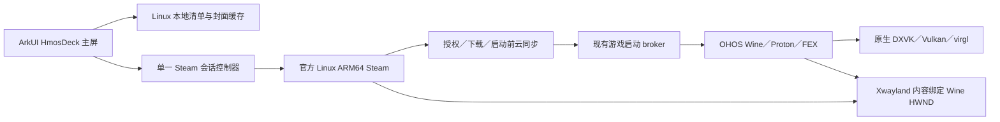
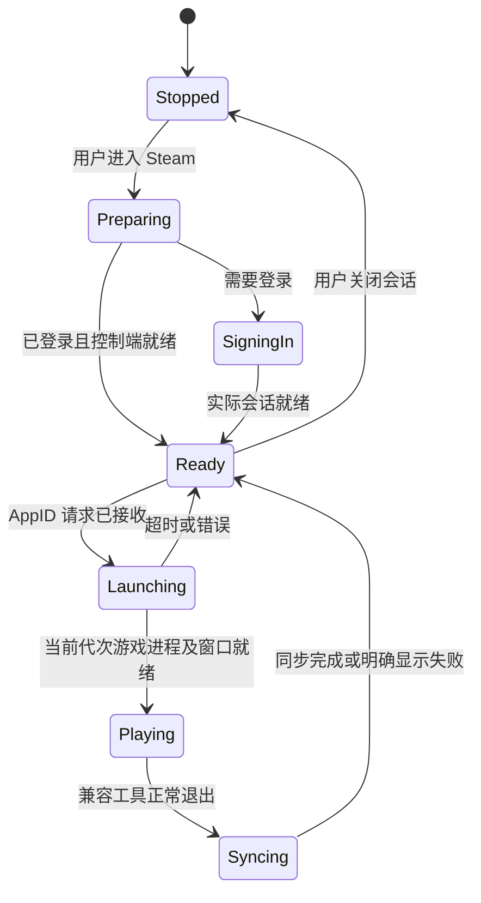

# HmosDeck 主界面与 Linux ARM64 Steam 联动评估

2026-10-20。研究对象为官方 [Droid-Deck/DroidDeck](https://github.com/Droid-Deck/DroidDeck)，源码固定在 `6bbcf3ad8be8ef1b80a97bf5f3444e4e001749b9`，避免把同名远程控制软件当成目标。

> 后续实施以 [经典／Deck 产品设计](DECK_PRODUCT_DESIGN.zh-CN.md) 为准：保留经典界面，旧 ArkTS Steam 登录／独立库页退出 Linux 产品路径，Deck 与官方 Linux Steam 联动；首次资源的目标是联网安装并提供独立更新，当前仍需已导入的外置组件。下文为上游研究和早期接入设计，其中“手动导入”只保留为维护手段。

## 已确认的上游实现

DroidDeck 包含两套不同的界面：Android 原生 Kotlin / Jetpack Compose 启动器，以及 Valve 官方 Steam Big Picture。原生启动器没有重写 Steam 的登录、商店或云同步。`HomeApp.kt` 管理 Android HOME 角色，也不是 Steam 通信桥。

| 部分 | 实际实现 | 在现有工程中的对应 |
| --- | --- | --- |
| 主屏 | `SteamHome` + `LiftHero`，深色背景、封面墙／少量游戏的扇形封面、左侧标题和启动按钮、设置面板 | ArkUI 原生可选 HmosDeck 主题 |
| 本地游戏库 | 扫描 Linux 客户端各 library 的 `steamapps/appmanifest_*.acf`，过滤已安装状态，读取 `LastPlayed`；封面、hero 和图标来自 `appcache/librarycache` | 专用 Linux 游戏库数据源，不读取 Windows Steam 安装目录 |
| 已运行会话启动游戏 | Android service 验证 gameId、会话代次及 READY 状态，原子写入 `steam-game` 文件；guest supervisor 消费并向实际 Linux Steam 发送 `steam://rungameid/<id>` | 当前 supervisor 增加有界结构化请求／响应；Steam 保持游戏启动与同步的所有权 |
| 新会话 | SessionActivity／SessionService 创建 Linux 会话并带 Steam URI | 使用当前最小 GNU runtime 和 Wine HWND 承载，不照搬 Android rootfs／proot |
| Steam 桌面／大屏 | 上游桌面 `-nobigpicture`；大屏 `-gamepadui`，Deck 模式另加 `-steamdeck -steamos3` | 经实际 ARM64 Steam 切换模式，保留已有 Wayland／Wine 绑定 |
| 合成与游戏 | 上游 gamescope + Xwayland，GNU Proton 在同一 Linux 环境 | 继续采用 OHOS Wine/FEX/Proton/DXVK，GNU Steam 通过现有游戏 broker 和 SteamAPI 桥交接 |

源码依据：

- [原生 Steam 主屏](https://github.com/Droid-Deck/DroidDeck/blob/6bbcf3ad8be8ef1b80a97bf5f3444e4e001749b9/app/src/main/java/com/droiddeck/launcher/ui/SteamHome.kt#L81)
- [主题和配色](https://github.com/Droid-Deck/DroidDeck/blob/6bbcf3ad8be8ef1b80a97bf5f3444e4e001749b9/app/src/main/java/com/droiddeck/launcher/ui/Theme.kt)
- [本地游戏库与封面解析](https://github.com/Droid-Deck/DroidDeck/blob/6bbcf3ad8be8ef1b80a97bf5f3444e4e001749b9/app/src/main/java/com/droiddeck/launcher/frontend/Library.kt)
- [主屏游戏启动](https://github.com/Droid-Deck/DroidDeck/blob/6bbcf3ad8be8ef1b80a97bf5f3444e4e001749b9/app/src/main/java/com/droiddeck/launcher/MainActivity.kt#L526)
- [会话队列和代次校验](https://github.com/Droid-Deck/DroidDeck/blob/6bbcf3ad8be8ef1b80a97bf5f3444e4e001749b9/app/src/main/java/com/droiddeck/launcher/session/SessionService.kt#L965)
- [实际客户端启动及模式参数](https://github.com/Droid-Deck/DroidDeck/blob/6bbcf3ad8be8ef1b80a97bf5f3444e4e001749b9/tools/linuxfs/overlay/usr/local/bin/droiddeck-session#L774)
- [复用已运行客户端的 URI 调用](https://github.com/Droid-Deck/DroidDeck/blob/6bbcf3ad8be8ef1b80a97bf5f3444e4e001749b9/tools/linuxfs/overlay/usr/local/bin/droiddeck-steam-launch)
- [显示尺寸实验与 resize storm](https://github.com/Droid-Deck/DroidDeck/blob/6bbcf3ad8be8ef1b80a97bf5f3444e4e001749b9/docs/development/steam-display-scaling.md)

## 建议采用的结构



图中的两个窗口来源共享现有合成器与任务管理；Steam 的 X11 像素内容没有转成 Windows Steam，也不需要 Windows Steam DLL。游戏启动必须经过 Linux Steam 的认证与同步，再由注册的兼容工具交给 OHOS Wine。不能让新主题通过直接执行游戏 EXE 绕开这条路径。

主屏使用 ArkUI 重建相同的视觉组织：暗色底、蓝色主操作、横向最近游戏、封面聚焦放大、渐变 hero 区、底部手柄操作提示；大屏／窄窗用可用宽高切换布局。新增主题作为可选择的外观，既有会员、设置、文件管理和 Windows 游戏入口继续由原服务承担。本轮未拷贝上游 Kotlin 代码或图片进产品。

## 数据与控制边界

1. `LinuxSteamLibraryService` 只扫描已验证的外置 `SteamLinuxARM64` 根和注册的 Linux library。用现有 VDF parser 读取安装清单，AppID 去重，并与路径边界、文件大小限制一起校验。游戏封面从客户端本地缓存加载，缺图使用占位；缓存缺图不能当成拥有游戏的证明。完整拥有列表与下载进度应从 Linux Steam 的已认证接口取得，不能凭空从 manifest 推导。
2. `LinuxSteamSessionService` 管理 `Stopped → Preparing → SigningIn/Ready → Launching/Playing → Syncing → Ready`。所有命令包含 requestId、会话代次和允许的 action；原子写入、确认应答、超时及取消；同一请求只消费一次。仅接受枚举动作及严格 AppID，不接受任意 shell／EXE／URI。
3. 最小动作是显示已有 Steam、打开库／下载、切换桌面／Big Picture、启动指定 AppID、恢复游戏、返回主屏。服务端只映射固定 Steam 指令。窗口恢复和模式切换复用同一会话，不能每点一次重启 Steam。
4. 退出游戏后等待兼容工具退出和 Steam 云同步结果，再显示已同步／待重试。不能把 Wine 退出事件直接当成云同步成功；主屏不持有或复制 Steam 登录凭据。
5. 焦点决定输入去向：ArkUI 主屏消费手柄导航；Steam HWND 前台用 Steam 导航；游戏前台恢复游戏配置。切换前释放按下状态，禁止同时向 ArkUI、Steam 和 Wine 重复注入。

## 全屏与大屏的尺寸策略

2026-10-20 手机布局补充：固定提交的 `MainActivity.kt:161` 默认 `SCREEN_ORIENTATION_SENSOR_LANDSCAPE`，在 `749–750` 行从 SessionPrefs 读取方向并应用，不是默认手机竖屏布局。`SteamHome.kt:90,130,147` 使用 LocalNarrowPane，把窄区间距从 44dp 降为 20dp、字标从 40dp 降为 30dp。HmosDeck 沿用其深色层次和窄区间距思路，另做 ArkUI 竖屏布局：可用宽度低于 600vp 且高大于宽时使用底部导航、两列卡片、可横滑分类；横屏／大窗用侧栏，短屏侧栏可滚动。没有照搬 Android 的方向锁定，也没有把 Steam 渲染分辨率用于主屏排版。

普通 Steam 首次启动默认最大化铺满 Wine 工作区；用户通过 Steam 原生窗口按钮还原后保存模式与正常窗口尺寸，下次沿用。保存仅由真实 Steam 桌面主窗产生，登录框、临时窗、最小化和 Big Picture 不覆盖该配置。Big Picture 全屏与普通客户端最大化分别处理，退出全屏恢复之前的桌面模式；首页启动按钮不再每次强制打开 Big Picture。

分别管理宿主可用尺寸、Steam 界面渲染尺寸和游戏分辨率。普通启动窗从真实 Wine work area 计算并居中；Xwayland 初始尺寸等于该 HWND 客户区。最大化使用 work area，全屏使用 monitor area，退出全屏恢复之前窗口矩形。

Big Picture 使用实际客户端的 gamepad UI。Steam UI 可先按约 720p 级别渲染再由现有合成器适配大屏，游戏仍用独立配置。不能让 Steam 的窗口变化强制修改游戏分辨率。上游的双 Xwayland／强制全屏实验出现过缓冲堆积与 resize storm，因此不应把 gamescope 参数当成这里的通用修复；当前显示桥也不能宣称实现了完整 SteamOS gamescope 协议。

GPU 加速是另一个验收项。平板／手机均不能因添加 `-cef-force-gpu` 参数就宣称开启成功；手机此前 CEF 缺字在禁用 GPU 后恢复，默认继续使用已验证路径，待真实 renderer、文字、滚动和模式切换回归通过后再开放。

## 实施顺序与验收

先完成当前滚轮／滚动条与初始窗口尺寸实机回归，再增加 Linux 清单数据源和带应答的会话控制。随后接入可选 HmosDeck ArkUI 主题，最后验证 Big Picture 与游戏之间往返。

主题验收需覆盖：无 Steam 资源／未登录／已登录但无安装游戏；本地安装与删除后刷新；同一 AppID 多 library 去重；主屏启动游戏经过 Linux Steam；云同步失败能明确显示；最小化恢复、桌面↔大屏↔游戏↔主屏不丢失窗口；手柄焦点不串场；手机和平板分别回归。现有手机故障独立保留，平板验证不能作为手机通过的依据。


## 待移植页面与现有工程接入设计

本节记录最初的接入设计；2026-10-20 已实现 ArkUI Deck 主题、Linux 安装清单与封面缓存、单一会话控制和返回／恢复。当前视觉实现见文末，实机结果见 [Deck UI 平板验收](DECK_UI_TABLET_20261020.zh-CN.md)。联网首次安装／独立更新仍未交付。依赖详见 [THIRD_PARTY_RUNTIME.zh-CN.md](THIRD_PARTY_RUNTIME.zh-CN.md)。

主屏采用原生 ArkUI，沿用现有主题切换设置。视觉按 DroidDeck 的信息层次重建，不引入 Android Compose、HOME service 或新的 WebView 外壳：

| 页面／区域 | 展示与行为 | 数据与现有接入点 |
| --- | --- | --- |
| 顶部状态栏 | Steam 会话状态、通知／下载、设置；未安装时显示联网安装入口 | 会话服务与现有 AppSettingsStore；会员入口仍进入现有整改流程 |
| 最近游戏 hero | 背景渐变、当前封面、大标题、继续／启动主按钮；聚焦有轻微缩放 | Linux 清单 + librarycache；保留可读文字、焦点边框和无封面占位 |
| 横向最近游戏带 | 按 LastPlayed 排序，触摸横滑、方向键／手柄逐项移动 | 安装状态、最近记录；不从 Windows Steam 取数据 |
| 完整库 | 网格、名称检索、已安装筛选、空状态；手机窄窗降低列数 | 已安装来自 appmanifest；未安装但拥有的游戏暂交实际 Steam 库，后续再接认证目录接口 |
| 游戏详情 | 封面、安装／更新／启动状态、兼容配置入口 | 启动发 AppID 请求；图形、输入、FEX 等设置复用现有游戏配置服务 |
| 正在运行 | 恢复游戏、显示 Steam、返回主屏；不新增悬浮任务管理模式 | HostWindowTasks + WineWindowManager／现有任务栏，按窗口代次恢复 |
| 下载／商店／账号 | 显示同一 Linux Steam 会话的对应页面 | 不重复实现登录和支付，不读取或复制登录票据 |
| 设置抽屉与底部提示 | Steam 桌面／大屏切换、输入与主题；A 确认／B 返回提示随当前输入方式变化 | 现有输入方案、音频、会员和设置页面；只在主屏拿到焦点时消费导航 |

平板宽屏用左侧标题操作区 + 右侧封面带 + 下方库；手机横屏把 hero 高度压缩、操作与封面上下布置，避免简单按平板比例缩放。以 vp 与可用区域布局，Steam 的 X11 像素尺寸不参与 ArkUI 主题排版。大屏模式可从主题直接进入实际 Steam Big Picture，退出后返回同一主屏或之前的普通 Steam 窗口，不能遗失窗口或切成第二个 Steam 实例。

### 代码拆分及接口

新增代码建议落在 `components/hmosdeck/`、`model/LinuxSteamModels.ets` 和专用 service，`Index.ets` 只根据主题挂载入口。复用以下已有模块：

- `LinuxSteamDiagnosticData` 的外置根／清单校验与导入。产品入口需从 SmokeRunner 的有界诊断流程抽出会话生命周期，不把测试 Want／四小时计时器直接当作产品会话。
- `steam/SteamLocalRules` 的 VDF 解析、`LinuxSteamLibraryLayout` 的单库布局。新增只读目录服务，按变化刷新与缓存，避免每帧递归扫盘。
- `LinuxSteamGameLaunch`／GNU hmosdeck 兼容工具的游戏交接、SteamAPI 桥及退出状态；新 UI 只请求 AppID 启动，继续沿用 Linux Steam 的认证和 Cloud 流程。
- `LinuxSteamWindowHost`、`HostWindowTasks`、`AppSessionService`、`WineWindowManager` 承担同一 Steam HWND 和游戏窗口的激活、最小化、恢复与退出。
- `InputProfileService`／`GamepadManager`／`InputOverlayWindowCoordinator` 管理前台输入。主屏、Steam、游戏三者之间先 releaseAll，再切接收者；不能同时映射键盘导航与 SDL 事件。

建议的数据契约（第一阶段不对外承诺完整 Steam Web API）：

```ts
interface LinuxSteamGame {
  appId: string; name: string; installed: boolean;
  installState: number; lastPlayed: number;
  coverPath: string; heroPath: string; libraryId: string;
}
interface LinuxSteamCommand {
  version: 1; requestId: string; generation: number;
  action: 'showLibrary' | 'showDownloads' | 'showStore' | 'setMode' | 'launchGame' | 'restoreGame';
  appId?: string; mode?: 'desktop' | 'bigPicture';
}
interface LinuxSteamCommandResult {
  requestId: string; generation: number;
  status: 'accepted' | 'completed' | 'failed';
  errorCode: string; message: string;
}
```

`accepted` 只表示请求被当前会话接收；游戏必须等真实进程／窗口出现才进入 Playing。Cloud 状态单独发布 `unknown/pending/syncing/synced/error`，没有可靠结果时保持 unknown，不把正常退出当成 synced。程序退出／崩溃后清空旧 generation 的待办；同一 requestId 不重复启动；账号切换刷新账号相关缓存。



图中的 Ready 需通过真实会话握手判定，不能靠“进程存在”或固定延时。离线模式须显示离线，云同步状态不可假定成功。所有请求由固定枚举映射为客户端动作，不允许任意 shell 或任意文件路径；启动时使用校验后的 AppID 与库注册信息。

### 分期落地

1. **基础窗口与输入**：普通启动、尺寸适配、大屏往返、最小化恢复、双指滚动稳定；手机问题保持独立状态，不能由平板结果覆盖。
2. **会话服务与目录**：从诊断入口抽出可复用生命周期；有版本的请求／ACK／generation；只读 Linux 本地库和封面。先交付能显示真实已安装游戏并启动的简洁界面。
3. **可选 HmosDeck 主题**：实现 hero、封面带、库与设置抽屉，接现有输入／游戏设置。默认主题可回退；第一次使用提供联网安装及打开实际 Steam 的清楚入口。
4. **完整往返**：主屏→Steam 登录／下载→游戏→同步→主屏；大屏↔普通窗口；触摸、双指、键盘、实体手柄各验收。缺失云同步结果／API 桥功能显示实际限制。

上游目前选择性源码缓存用于理解实现，尚未引入 Kotlin 代码、封面素材或第三方 UI 库。若随后直接复用代码或资源，先核对固定提交相应 LICENSE 与文件声明，在对应交付中保留；新 ArkUI 布局复用现有主题／组件与公开客户端缓存图像，不把研究缓存打包进 HAP。


## 2026-10-20 原生视觉实现

用户要求按 DroidDeck 配色、风格、美术与动画重新实现。参考固定提交 `6bbcf3ad8be8ef1b80a97bf5f3444e4e001749b9` 的 Theme、SteamHome、SideRail、LiftHero 和按钮交互，当前 Deck 首页已替换早期顶部按钮＋蓝色 hero 原型。实现使用 ArkUI，没有引入 Compose／Android 运行时，也没有修改 Steam 网页或假扮 Steam 登录界面。

- 配色：Graphite 背景 `#0A0B0D`、侧栏 `#121417`、层级表面 `#1A1D22`、分隔 `#262A31`、正文 `#F2F4F7`、次要文字 `#9AA3AF`、Steam 蓝 `#1A9FFF`、按钮渐变终点 `#1487DB`。
- 构图：左侧窄导航，首页右侧整页封面，左下 HMOSDeck 字标与启动按钮。少量游戏显示扇形封面；四款及以上使用倾斜封面墙。无安装游戏时使用抽象卡片，不虚构拥有的游戏。
- 动画：封面使用 9／11／13 秒缓动往返，封面墙 40 秒循环，聚焦放大、按下缩小，选项面板升起与遮罩淡入。动画由 ArkUI 合成执行，没有 JS 逐帧定时器；页面隐藏／展开选项时暂停背景运动，并提供静态显示开关。
- 信息层次：安装库与本地游戏独立于首页；下载／商店／账号打开同一官方 Linux Steam 会话。Steam 选项展开面板将客户端、显示与系统分组，经典入口始终可见。
- 图片：仅通过真实安装 AppID 请求 Valve 公共封面 CDN；有界下载、两路官方源、图片头及解码尺寸校验、临时写入后原子替换、本地缓存。离线显示带游戏名的渐变占位。Steamworks 公共运行库不作为游戏卡片。
- 返回：沿用 Wine 桌面承载与虚拟按键工具栏，新增返回主屏动作；Deck 的继续操作恢复已有 Wine 宿主，不创建额外任务浮窗，也不重启 Steam。

上游 GPL-3.0 源码仅留在研究缓存用于核对设计；本轮 ArkUI 代码独立实现，未打包其 Kotlin 文件、字标路径或封面资源。界面使用自身 HMOSDeck 字标及系统符号，游戏封面由设备按真实 AppID 获取。第三方运行时列表和未完成的联网安装／更新发布条件仍见 THIRD_PARTY_RUNTIME.zh-CN.md 与 DECK_PRODUCT_DESIGN.zh-CN.md。
