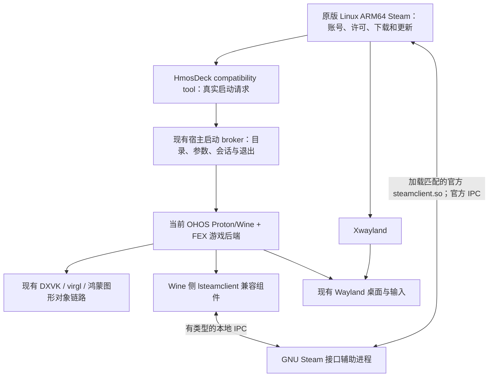

# Steam 下载、Wine 启动与 Steam API 桥接设计

设计基于当前工程与 2026-10-19 源码核对。已实现兼容工具与宿主启动交接，完整游戏认证及运行仍待验收。用户约束：保留当前 OHOS Proton/Wine 和图形对象路径；Steam 原生 ARM64；GNU／Valve 资源外置；Linux 客户端和下载库与 Windows Steam 完全隔离。

## 职责与进程边界

将 Wine 侧 Windows 接口包装、注册表／路径适配和 Steam 回调派发作为 Wine 配套兼容组件维护；Steam/GNU 装载、外置资源、辅助进程及会话调度留在宿主模块。可在产品中统一分发和启停，但不把 GNU libc 混入当前 Wine 进程。Steam 通道不携带 OHNativeWindow、EGL/Vulkan handle 或 virgl 上下文。

DXVK 仍由当前 Wine 加载匹配的 Windows PE DLL；游戏 Vulkan／OpenGL 调用继续走现有 OHOS 图形后端。GNU Steam 的登录、下载和 Steam API 辅助进程不要求将游戏迁入 GNU Wine，也不要求先实现 GNU Vulkan ICD。DroidDeck 采用 glibc Turnip 访问高通 KGSL 的做法说明 GNU 图形可以访问 GPU 内核，但它依赖 Adreno 驱动支持，不能直接套用于 Maleoon。详见源码对照中的 DXVK／GPU 章节。

## 库位置

目标库为 `Z:\SteamLinuxARM64\library\steamapps\common\<游戏>`，对应当前已确认的 `/storage/Users/currentUser/Download/com.vintage.pomelopro/SteamLinuxARM64/library/steamapps/common/<游戏>`。原生客户端数据使用 `Z:\SteamLinuxARM64\client\.steam\steam`，程序和 GNU runtime 位于 `Z:\SteamLinuxARM64\releases\<hash>\runtime`。原 Windows `Z:\Steam` 不导入、不复制、不修改。Linux Steam 中配置真实 Linux 库路径；Wine 按同一目录转换为 Z: 路径，不复制第二份游戏。

由原版 Steam 注册并管理 libraryfolders、appmanifest、下载中数据、更新和校验。兼容工具按 Steam 的正常机制选择 Windows depot；不把下载到的 Linux depot 当作 Windows exe 启动。受文档存储软链接、权限及可执行映射限制影响的 prefix、IPC、锁与运行状态保留在私有目录，由稳定的 AppID／库标识映射；不能简单假设整个库有完整 ext4 语义。已在原生 Steam 设置中验证独立的 HmosDeck Linux 库和 HmosDeck (OHOS Wine) 工具，用户已开始下载《仙剑奇侠传》（AppID 695630，NewPAL）；尚未证明下载完成。

## 启动到退出

1. 原版 Steam 处理账号、许可、下载／更新和正常启动选项。通过已注册的 HmosDeck compatibility tool 发出 verb、argv、工作目录、AppID、安装目录和 compatdata 等上下文。
2. 工具入口为受支持的 ARM64 GNU 小程序。保留参数数组与 verb，不拼接 shell 命令；向已认证的宿主本地会话端点提交请求。它作为 Steam 的受控子进程等待本轮游戏，而不是发出请求后立即返回成功。
3. 宿主验证本轮会话、库路径和运行配置，将 Linux 安装路径转换为现有 Wine 能访问的 Z: 路径。通过现有 Wine 启动 broker 选择 prefix／FEX／DXVK 等配置，不由 GNU preload 接管所有 exe 或 exec。
4. 先启动或连接本轮 Steam 接口辅助进程，为游戏登记 AppID、接口版本和 RPC 会话。游戏原有 steam_api/steam_api64 DLL 保留；由受控 Wine 配置接上匹配的 Steam client 兼容组件，不能全局替换所有 Windows Steam 会话的 DLL。
5. 游戏请求 Steam 接口时，Wine 组件调用 GNU 辅助进程，后者通过官方 steamclient.so 与真实客户端通信。许可、票据、DLC、异步结果按实际接口返回；离线或客户端退出按真实状态处理。
6. broker 跟踪启动器与游戏进程树，避免启动器先退就让 Steam 提前显示停止。实际游戏结束后回收本轮句柄、回调和辅助进程，将真实退出状态交还兼容工具；取消与崩溃有独立状态。

Steam 的前置许可处理不代表游戏之后不再认证。SteamAppId 环境变量、steam_appid.txt、拥有状态查询都不能代替官方运行时会话与认证票据。第三方启动器、内核反作弊、Overlay、Steam Input、Cloud 等另列接口和验收范围。

## 跨进程 Steam API

优先复用上游 lsteamclient 的 Windows ABI、接口版本表及数据转换生成流程；只增加明确的 remote backend。上游 `WINE_UNIX_CALL` 是同进程调用，不是可直接网络传输的协议。

- Wine 进程持有 Windows 对象、函数指针和回调注册；GNU 辅助进程持有真实 Linux steamclient 对象。通过对象 ID、代次和会话表关联；不跨进程解引用原始指针。
- 每个方法定义字符串／数组长度、输入／输出、结构布局和释放责任。普通消息使用有界 Unix socket；确需大块数据时另验共享内存。不能只序列化外层 struct。
- 异步调用和回调使用请求 ID、真正的调用结果及独立回调队列；由游戏侧正常 RunCallbacks 路径派发，避免同步调用中反向执行导致死锁。
- 断连、超时、注销、取消票据和释放对象保持可见失败。未知接口版本返回明确不支持，不返回假的初始化成功。
- 端点按会话隔离，核验真实 peer 身份及启动凭据。日志不输出账号、票据或登录凭据；使用真实客户端会话，无需把 Steam 密码传给宿主。
- 先验证当前主力 64 位游戏 ABI，再验 32 位／WoW64；调用延迟与高频接口另做性能测量。只读拥有状态成功不能提升为完整 Steamworks 兼容。

## 窗口融合

Steam 仍是 Linux 程序，无需伪装成 Windows exe。将其 Xwayland surface 登记到现有会话／窗口模型，提供桌面内移动、缩放、关闭和正确焦点／层级；Wine 游戏继续走现有 Wayland surface。近期可先管理整个 rootful Xwayland surface，后续再评估 rootless/XWM 的逐窗口集成。

external-65 已验证独立 OHOS 子窗口显示、点击、边缘缩放和 Steam 菜单正常退出。它覆盖主 App 是 managed-subwindow 的呈现结果。external-66 切到共同 Wine 桌面后，实际创建了 Wine Notepad toplevel，但未验证两者同时正常显示／交互：Steam 内容变黑、点击未见更新，根因未确定。不能以配置中 virtual 或同一个 compositor 为由宣称融合完成。

## 近期实施落点与风险收敛

采用两套运行时共用一个宿主：GNU 原生 Steam 管理账号／下载／许可，当前 OHOS Proton/Wine 运行 Windows 游戏。通过兼容工具交接启动，通过独立 Steam API 桥接进程保持运行时认证；图形和桌面显示由现有 OHOS 宿主管理。下表保留整体验收目标；当前已实现的交接范围和未完成项见末尾实施记录。

现有 `WineEngineService.launchExecutable(executable, argumentsValue, workingDirectory, envOverrides)` 已按参数数组、工作目录及环境变量调用 `runWineExe`，并沿用当前选择的 D3D 后端。兼容工具请求应交给此接口及其现有 native process broker，不创建第二套 Wine 命令拼接器。启动请求受理／取得 PID 不等于游戏成功：仍需跟踪启动器、游戏进程树、退出和取消。

| 顺序 | 范围 | 实际通过条件 |
|---|---|---|
| 1：认证可行性 | 独立 GNU helper 加载官方 ARM64 steamclient.so；Wine PE 探针通过匹配的 lsteamclient 兼容组件访问它 | 先验证真实 pipe/user、登录与拥有状态，再验证真实接口初始化、一个异步回调及有适用测试对象的票据取得／取消。Steam 退出、未登录和未知接口版本均返回真实失败；只读查询成功不能越级判定完整认证可用 |
| 2：启动交接 | 注册 GNU compatibility tool，将 AppID、argv、cwd、库与 prefix 上下文交给宿主，复用 launchExecutable | 使用受控测试程序验证中文／空格路径、参数、启动器派生子进程、停止按钮和真实退出状态；不先下载账号游戏来猜桥接错误 |
| 3：产品会话与库 | 将原最长 15 分钟的诊断入口改成受宿主管理的正式生命周期，注册独立 Z:\SteamLinuxARM64\library 库；prefix／IPC／锁保留私有目录 | Steam 与游戏生命周期可分别管理，重启不重复会话，当前有效登录配置不被并发改坏，路径一致且没有第二份游戏文件；下载／校验另验 |
| 4：真实游戏与窗口 | 用户指定的已拥有 Windows 游戏从原版库启动；Steam Xwayland 与 Wine Wayland 窗口纳入同一桌面 | 正式 Steam API／该游戏认证、游戏运行／退出、Steam 运行状态均正确；再验共同桌面层级、焦点与输入。独立子窗口显示通过不能代替共同桌面融合 |

跨 libc 的 Steam API 桥是主要新增工作量。应复用上游 lsteamclient 的接口版本表和生成流程，逐接口生成有类型封送，而不是只补几个特定游戏函数或把原始指针跨进程发送。首轮明确支持的接口和版本，未实现的接口返回可诊断失败。回调、票据、第三方 DRM、Steam Input、Overlay 等分别验收，不承诺一款游戏通过即覆盖全部 Steam 游戏。

GPU 暂不增加新的跨 libc Vulkan 转发层，不迁移当前 Wine，也不以开启 Steam CEF GPU 为上述阶段的前提。窗口融合可以并行做小范围修正，但应在认证可行性取得证据后再扩大 UI 和库管理改造。

## 实现顺序与通过条件

1. GNU 侧只读探针：真实连接现有登录 Steam，查询指定 AppID 的拥有状态，释放 pipe/user；客户端退出与未登录时返回真实失败。可参考 DroidDeck 的现有小探针。
2. Wine → GNU 请求／响应：用当前 OHOS Wine 的小 PE 探针验证参数封送、对象释放、真实 SteamUser/SteamApps 查询及回调，不接图形对象。
3. 完整最小 Steam API：SteamAPI_Init、必要的 SteamClient/User/Apps/Utils、真实票据取得／取消及异步完成；按接口列出支持范围。
4. compatibility tool：先启动受控无 DRM 小程序，核对空格／中文路径、cwd、argv、子进程、退出码及停止按钮；再注册独立 Linux 游戏库和验证下载／校验。
5. 用户指定的已拥有 Steam 游戏：从原版库启动，实际通过其 Steam API／DRM、运行、退出并让 Steam 正确回到未运行状态。没有这项不能宣称 Windows Steam 游戏链路完成。
6. 修正共同桌面显示／输入并做回归；再逐项加入 Overlay、云存档、Steam Input 和更多 ABI／游戏。

2026-10-19 首轮已验证 GNU 官方 Steam 只读接口与当前 Wine Windows x64 PE → GNU 的诊断通信；loggedOn=true 与 user／pipe 释放取得实机证据。真正的 lsteamclient backend、SteamAPI_Init、回调／票据仍待实现；兼容工具和独立库的后续进展见下文；详见 [首轮接口验证](STEAMCLIENT_PROBE.zh-CN.md)。此设计不切换 GNU Wine；现有 DXVK、virgl、鸿蒙对象和独立游戏入口继续作为游戏后端。

参考的 DroidDeck 与 Proton 固定源码及适用边界见 [源码对照](DROIDDECK_REVIEW.zh-CN.md)。

## 2026-10-19 v35 实施记录

GNU compatibility tool 已注册到原版 ARM64 Linux Steam，界面可选择 HmosDeck (OHOS Wine)。工具通过每会话私有 Unix socket、随机凭据、UID 和 NCP 进程祖先核验提交有界参数数组；宿主验证真实库路径和 PE 文件后复用 LinuxSteamGameLaunch → WineEngineService.launchExecutable，保留当前 Wine/FEX/DXVK 图形后端。主机测试覆盖真实工具／broker 进程、参数封送、路径越界、连接取消和真实退出码。此测试不能代替实机游戏启动。

当前仅追踪 launch root session；启动器退出后交给子游戏的完整生命周期尚未实现。Steam API 仍没有完整 lsteamclient remote backend，不伪造 SteamAPI_Init 或认证成功。验证时拒绝并发 Windows Steam；Wine prefix 仍使用现有产品 prefix，不能称为独立 prefix。

external-74 的下载退出已从客户端结果定位为 SIGSYS syscall=437（openat2），退出码159、非超时，未进入 HMOSDECK 工具。v35 的兼容层只在 scoped native-memory 环境返回 ENOSYS，让原版 Steam 自行选择旧内核路径，不把 resolve 约束悄悄降级为 openat 成功。主机测试包含 ENOSYS、RESOLVE_BENEATH、调用方 fallback 和未启用 scoped 标志时正常转发。external-76 在 USB 平板恢复下载，content_log 记录约75–87 Mbps，独立库 appmanifest_695630.acf 随后从1026变为4（Fully Installed）；该证据不代表实际游戏认证或运行成功。

会话预算已延长到4小时，仍为有界研究入口，不等同于正式产品生命周期。根据用户最新要求默认全屏运行，Wine 桌面逐窗口融合暂缓。

external-75 的资源准备失败来自 HDC 目录传输未落到预期嵌套路径；改为发送并校验 compatibilitytools.d/hmosdeck/hmosdeck 单文件后，external-76 激活成功。v35 全屏仍显示加载动画，但后台下载已完成。v36 将自动 X11 bounds supervisor 改为 desktopSession=bounds 显式诊断，默认全屏不干预 Steam 客户端窗口位置；实机显示对照另记。

v36 禁用默认 bounds supervisor 后，全屏 virtual 承载仍停留在加载动画，未证明 bounds 是该现象的直接原因。v37 改为独立 fusion/subwindow 承载并传递 desktopFullscreen=1 → 原版 Xwayland -fullscreen，通过现有 Wayland fullscreen 事件处理将承载铺满屏幕，暂缓共同 Wine 桌面路径。

v37 external-78 已取得独立全屏承载的实机证据：2560×1600、商店／库切换正常、《新仙剑奇侠传》详情“开始游戏”可见。该轮页面提示云状态未同步，未做存档覆盖选择。后续启动结果见 external-79 记录。

## external-79 启动交接与窗口管理反馈

external-78 在 Steam SDK wrapper 处 ENOENT；新增精确别名与工具包装模式后，external-79 已经过官方 reaper 到 HmosDeck，再由认证 broker 到现有 Wine。取得 `wine_process_started_authentication_unverified` 与真实游戏窗口，用户确认游戏能启动，随后反馈最小化后找不到恢复入口。完整 Steam API、存档同步与子进程生命周期仍待验收。

统一任务登记和宿主窗口切换为下一落点，详见 [统一窗口与任务方案](DESKTOP_INTEGRATION.zh-CN.md)。不将 Wine 与 GNU 运行时合并，也不以修改游戏 DLL 解决窗口问题。
