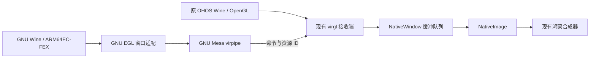

# GNU ARM64 Proton 独立运行实验

截至 2026-10-26，GNU GE-Proton11-11 ARM64EC/FEX、WoW64/FEX 已接入 Linux ARM64 Steam 正常兼容工具入口，并开始随 1.5.2 自动交付。使用 fork backend，只操作手机，没有使用 QEMU 或 Windows Steam 客户端。

## 后端边界与当前状态

2026-10-25 早期从 Steam 启动《仙剑四》的成功记录实际使用原 OHOS Wine，已明确区分。后续完成 GNU 工具分发、2 GiB PE 地址语义、短路径驱动器、NLS 与字体修复后，真实 GNU 路径已进入《仙剑四》游戏；原配置工具和游戏中文正文也分别确认正常。早期退出码 5 的结果保留为历史证据，不能再当作当前状态。

默认 GNU 工具保留 D3D9 WineD3D/virgl，D3D11 使用 DXVK/Venus；另保留 GNU WineD3D 与原 OHOS Wine 供 Steam 保存逐游戏选择。实际手动游戏无 600 秒硬上限，独立 smoke 代表游戏试验仍有有界时限。音频 x87 配置修正后用户已确认不再卡断。

自动安装、更新恢复与打包边界见 [GNU Proton 自动交付](GNU_PROTON_DELIVERY.zh-CN.md)。完成启动、音频或中文验证不代表全部游戏长期稳定性或全协议兼容。

## 实测结果

| 阶段 | 结果 | 边界 |
| --- | --- | --- |
| ARM64／x64／x86 命令 | 预期标记、退出 0 | 只验证进程与模块执行 |
| 独立前缀初始化 | wineboot -u 退出 0，约 15 秒 | 补齐 wine.inf 引用的 WinMD；非完整发行版依赖验收 |
| x64 GDI 窗口 | 手机实际显示、正常退出 | GDI 使用正常软件绘制 |
| GLX 对照 | virgl (Maleoon 920)、GL 3.1，120 次单像素读回正确 | Xwayland 仍有 SHM 整帧输出，不作为最终游戏呈现路径 |
| GNU Mesa 共享输出 | 两窗口各提交 240 帧，分别观测到至少 120 帧 NativeImage 消费；一个窗口中途缩放 | 不经过 Wine，验证接收协议及多窗口路由 |
| GNU Wine/FEX 共享 OpenGL | x64 fixture，480 帧绘制与交换检查通过；632×373 → 472×273，接收端至少消费 360 帧；退出 0 | 无 Xwayland、无 glReadPixels、无逐帧像素上传；非实际游戏或性能基准 |
| FBO 回归 | 离屏纹理附件、绘制目标、清屏通过；无效枚举仍产生真实 GL 错误 | 不伪造成功，不做像素读回 |
| GNU Wine/FEX x86 WineD3D | D3D9 立方体显示、正常退出；首轮接收端零失败 | 另一轮出现两次可恢复消费失败，该轮严格验收未通过 |
| GNU Vulkan/Venus | 360 帧清屏、640×400 → 480×300 缩放，NativeImage 消费零失败 | Vulkan 1.3.269、Maleoon 920；短时功能测试 |
| GNU Wine/FEX x86 DXVK 2.6.2 | D3D11 立方体 971 帧，退出 0；NativeImage 消费到 960 帧、失败 0 | 使用独立 GNU WSI，显示帧无 CPU 读回；非长期稳定性或游戏性能验收 |
| 音频 | waveOut／DirectSound → 原 Wine WASAPI 后端 → OHOS AudioBroker，退出 0；44.1／48 kHz 游标检查通过 | GNU 私有后端保持 GE Unix ABI，实际游戏听感待复验 |
| 《新仙剑》 | 原生 Linux Steam 会话、原 GE steam.exe／lsteamclient、32 位 FEX、共享 GPU 路径已进入片头及菜单，并有正常退出证据 | 音频已获用户确认修复；完整云存档与长期稳定性仍需扩展验收 |
| 手柄 | ControllerHub 合成动作 → SDL2 → Wine XInput，方向、两摇杆、扳机、A/B、松开均覆盖 | 不是实体手柄验证；事件到达可含中间状态 |

最终共享图形轮耗时 16013 ms，包含 480 帧每帧 20 ms 主动等待，不能换算为游戏性能。初始化仍有 GL 3.1 不支持的上下文查询和 GE 可选 GLSL 3.30 gamma shader 报告；记录初始化错误后，480/480 实际绘制和交换无错误。尚未修正 GE gamma shader，不能外推完整全屏后处理已兼容。

## GPU 架构：同一鸿蒙接收端

`gnu_fixture/proton_egl.cpp` 将原版 Wine 的 Wayland EGL 窗口连接到 Mesa pbuffer，通过原 present-page ABI 关联 surface ID，复用 `virgl_surface_presenter.cpp`、`egl_renderer.cpp`。NativeBuffer、NativeImage、EGLContext 归 OHOS 接收端所有，不跨 GNU/musl 传递裸指针。

- 复用 Mesa 提交 `557fa3e781ea6e78fcff3ee759c25f60c3055064` 已有 vtest present 支持，本轮未改共享 Mesa 源码。
- 渲染结果保留在 GPU 资源中；`WINEHUA_VTEST_PRESENT=1` 下跳过 transfer_get，实机 `transfer_get_candidate=0`。
- 建窗及改尺寸时只创建一次空白 SHM buffer 提供几何，不含游戏渲染结果；稳态没有逐帧 SHM 像素上传。
- 接收端沿用已有上下文、双向同步、窗口资源生命周期和 NativeImage 消费逻辑。
- **当前仍有接收端一次 GPU 全屏三角形合成，不是直接 scanout 或完全没有 GPU 合成。**避免的是整帧 GPU→CPU 读回及跨运行时搬运像素。
- EGL 后端限于固定实验目录、显式启用；多 display、完整扩展和销毁并发语义尚待完善，不能作为任意应用的通用 EGL 替换库。
- 不伪报 OpenGL 版本或驱动扩展，按真实设备能力工作。

## 本轮修正

1. 原版 GE 的 EGL 需 `WINE_USE_EGL=1`，仅在选择实验共享 EGL 时启用。
2. 接收端曾将“没有新 attach 的 commit”误当作“attach(NULL) 后 commit”，删掉 layer 且不回帧回调，导致原版 Wine 等待超时。新增 `pendingBufferAttached`：状态提交保留内容并回复回调，显式 NULL 仍卸载；不重传像素。回调使用单调毫秒时钟。
3. Wine 为窗口恢复多个 draw buffer（含 GL_NONE 填充），Mesa pbuffer 只有前缓冲。适配器只在窗口默认 framebuffer 上转换 GL_BACK/GL_BACK_LEFT，保留 FBO 附件、数组长度及错误语义。此前每帧的 glDrawBuffers GL_INVALID_ENUM 已消失。
4. EGL 每次 swap 提交 Wayland 状态，消费 Wine 排队的帧回调，不重新 attach 像素 buffer。
5. Smoke 从首页启动时恢复真实显示宿主到前台；未改变 exported 权限或用户持久窗口偏好。
6. 客户端 ready 文件只证明曾消费过，不能代替持续消费证据。早期后台试验曾耗尽队列；现按当前 producer PID、窗口 key、至少 120 帧消费、零消费失败与零 transfer_get 验收。
7. SDL 显式发布 D-pad 按钮并保留 hat，整组更新加锁。ALSA 修正匿名音频文件长度查询、游标回绕与部分写入。

## 依赖与隔离

归档来源、SHA-512、逐文件 SHA-256 见 [gnu-proton-probe.lock.json](gnu-proton-probe.lock.json)。GE 归档 648071663 字节，按闭包选取模块资源，不展开完整 rootfs；最新选取大小以 lock 为准。

实验根 `/data/storage/el2/base/files/steamohos-native/proton-probe` 有独立 HOME、TMPDIR、WINEPREFIX。GNU libc、libstdc++、字体、Wayland 等从既有 runtime 按字节核对复用；因系统限制符号链接，仅保留必要私有副本或受限路径记录，不复制游戏。

独立 `libproton_probe.so` 处理受限 posix_spawn/fork、可选 preloader 回退、映像身份、Wine 自带 PE 读取回退、旧 Wayland named queue ABI、私有 C: 映射。不改产品 exec allowlist、正常 GNU runtime、已有游戏账号和存档。GE Wine 二进制保持原包内容。

宿主原已实现 wl_output v4 名称描述但仅声明 v3，现声明与实现一致，按客户端协商版本发送事件，v1 不接收 done。GNU Wine 可以枚举显示器。

## 入口及验收

Smoke suite `linux-proton`、NAPI `probeLinuxProton()`，实验根 `stage` 选择：

| stage | 内容 |
| --- | --- |
| 无／bootstrap | 依赖与版本 bootstrap；未知 stage 明确返回不支持 |
| prefix、x64、x86 | 对应架构 Windows 命令 |
| init | 独立前缀 wineboot -u |
| window | x64 GDI 窗口 |
| glx | x64 GLX 读回对照 |
| native-present | GNU Mesa 双窗口共享输出 |
| gl-shared | GNU Wine/FEX x64 窗口、FBO、480 帧及缩放 |
| native-vulkan | 原生 GNU Vulkan 清屏与缩放 |
| d3d9-x86、dxvk11-x86 | 原版 GNU Wine/FEX 下的 D3D9／DXVK D3D11 立方体 |
| newpal | 真实 Linux Steam 会话与 GE Steam 助手的《新仙剑》启动实验，单次限时 10 分钟；完整游戏验收尚未完成 |
| audio | waveOut 声音桥 |
| input、input-actions | XInput 枚举／合成动作 |

通常子测试限时 40 秒、init 120 秒；独立 smoke 游戏试运行限时 600 秒；Steam 正常手动游戏不设该上限，上层预留清理时间。返回真实 timeout、errno、信号、childReaped、hostTpUnchanged。结果上限 128 KiB，镜像日志 8 MiB 轮转，详细 GPU 日志仅显式启用。结束只关闭实验前缀 wineserver。

客户端 `graphicsTransportSubmitted=true` 不是完整验收，`graphicsTransportVerified=false` 刻意保留此边界。接收端与提交记录联合生成 `*-validation.json` 的 `continuousConsumptionVerified`。旧 `graphicsVerified` 专指 GLX 读回结果；`gameVerified=false` 始终保留。

构建脚本包括 `build_linux_proton_probe.py`、`build_linux_proton_graphics.py`、`build_linux_proton_egl.py`、`build_linux_proton_shared_present.py`、`build_linux_proton_window_probe.py`、音频及 SDL builder；输入一致复用增量产物，输出均有身份记录。

本机证据固定在 `F:/VintagePomelo-Workspace/workspace_temp/linux-proton`：`gl-shared-current-result.json`、`gl-shared-validation.json`、`gl-shared.private.png`，对应 `native-present-*` 文件，以及音频、输入、候选身份和 `backend-parity.json`。截图初始 FPS 叠加不是性能数据。

检查通过：新增 `host_tests/wayland_state_commit_test.py`（生产函数、240 次状态提交及卸载重挂、ASan/UBSan）、既有 12 项 Wine Wayland 生命周期回归、真实 libwayland 资源销毁顺序测试。Release HAP 编译、debug 签名验签、201 项后端资源哈希核对通过；原 Wine/FEX/DXVK 库未替换。

## 网络分支

授权的 `097587f8` 已 cherry-pick 到 `main_proton_steamarm64`，新提交 `e2efe35d`；Makefile 追加 targets 冲突保留两边。WinHTTP、DNS、Nettle 主机回归及 ASan/UBSan 已通过，尚未 push。

该提交作用于 OHOS Wine 源码构建链，不会自动修改 GE GNU Wine。调试 HAP 沿用旧 Wine 预编译库，不能说设备已使用网络优化或验证提速；API 23、完整 Wine 重编及设备网络性能待验收。

## 后续关卡

1. 完善 EGL 生命周期、更多窗口／上下文组合和前后台验证，处理 D3D9 第二轮消费失败，接通实际 32 位 WineD3D 游戏。立方体通过不代表实际游戏已通过。
2. GNU Vulkan WSI／Venus 与 DXVK D3D11 已有独立实测证据；继续验证低地址映射生命周期和真实游戏所需交换链能力。沿用同一个 NativeBuffer／NativeImage 接收端，不用整帧读回；尚不承诺 HDR、多 GPU 或 D3D12。
3. 原生 lsteamclient、Linux Steam 会话及《新仙剑》片头／菜单已接通；继续验证声音听感、输入、前后台与正常退出后的云存档。当前仍不标记完整游戏通过。
4. GPU 资源归接收端、声音归 AudioBroker、输入归 ControllerHub；GNU 侧适配客户端 ABI，保留 OHOS Wine 稳定路径。

## GNU Venus / DXVK 2.6 实验进展

2026-10-25，手机 fork backend；没有操作平板，也未替换产品 OHOS Wine、FEX、DXVK 二进制。

- 原版 GNU GE Wine/FEX x86 → 已有 DXVK 2.6.2 PE → GNU Vulkan WSI → GNU Venus → 原 OHOS GPU 接收端 → NativeImage：D3D11 旋转立方体 971 帧，exit 0；接收端消费到 960 帧，失败 0，实际截图可见。此为约 12 秒的功能测试，不能当作长期稳定性或游戏性能保证。
- 原生 GNU Vulkan 360 帧清屏、640×400 → 480×300 缩放，通过 NativeImage 联合验证，失败 0。
- 32 位 Vulkan 映射曾因返回高地址而失败。GNU WSI 通过原 ntdll 的 NtAllocateVirtualMemory 管理低地址预留，使用同一 Venus BO 描述符建立 MAP_SHARED 视图；保持原高地址映射，无整块 CPU 复制。失败直接返回真实错误，不退回每帧复制。
- Venus 的变体只保留 BO 文件描述符到销毁，并导出受限的映射描述符获取函数。构建脚本在任务目录生成单文件及导出表变体，不改共享 Mesa 源码，不复制完整构建树。
- 连续呈现没有 glReadPixels、vkMapMemory 读回最终图像或逐帧 wl_shm 像素上传；仍保留建窗/改尺寸的空白几何 buffer，以及原接收端 GPU 合成。顶点/纹理资源上传和 Vulkan 映射同步不属于显示帧零复制的保证范围。
- 新增 WSI 的 acquire 超时、退役、唤醒、枚举、提交失败、队列互斥主机测试，ASan/UBSan 通过。

构建入口：`scripts/build_linux_proton_vulkan.py`、`scripts/build_linux_proton_venus.py`；使用已有 GNU 工具链、Mesa 增量构建和 GNU Wayland。`dxvk11-x86` 阶段使用原包中 x86 d3d11.dll / dxgi.dll；测试程序静态导入但不执行的 D3D9 入口仍用原 Wine builtin。

WSI 目前是显式实验范围：Wayland、单层普通交换链、FIFO、独占队列共享方式；高级 swapchain 扩展、HDR、多 GPU、D3D12 仍未验收。不能据此宣布完整 Proton 或所有游戏兼容。实际 Steam 会话与《新仙剑》已启动，但完整体验未验收，`gameVerified=false`。

证据固定保存在工作区 `workspace_temp/linux-proton/`：`dxvk11-x86-current-result.json`、`dxvk11-x86-render-result.json`、`dxvk11-x86-validation.json`、`dxvk11-x86.private.png`、`native-vulkan-validation.json`，不复制生成逐轮大包。

## 《新仙剑》音频卡断定位

手机上原 OHOS Wine 路径正常，GNU GE 路径在播放约二十秒后开始明显卡断。已建立独立 32 位诊断程序 `proton_vlc.c`，加载游戏未修改的 VLC 2.2.4，读取原有 MP3；不复制或修改游戏、素材和存档。

- WASAPI 生产端持续约 48000 帧／秒，接收端队列非空、underflow 增量为 0；播放器却反复报播放过晚、丢块、重置。增加播放缓冲不能修复上游丢块。
- 播放游标与单调时钟推进正常，VLC 切换 QPC 时钟后仍失败。完全关闭音频输出的 dummy 对照也复现，排除 DirectSound 混音、socket 和 AudioRenderer 作为该现象的必要触发条件。
- 对齐原 Wine 的 `FEX_X87REDUCEDPRECISION=1` 后，相同 30 秒 dummy 测试丢块从 48 次降到 0；DirectSound 有声对照也为 0，没有后期持续静音。严格模式下软件 F80 路径的开销是目前已隔离出的关键差异，尚不以单次短测保证所有媒体流畅。
- GNU 启动环境采用原 ARM Wine 相同的 F64 x87 默认策略；私有 GNU shim 对未设置值的旧测试包补充同一默认值，保留显式 `0`。没有更换原 GE FEX 二进制，也没有修改游戏。
- 同时修正 QPC 到 100 ns 的乘法溢出（手机 uptime 超过原 UINT64 中间乘积范围），主机边界测试与实机时钟对照通过。这是独立的正确性修复，单独应用时未解决卡断。
- GNU AudioBroker 构建现应用产品相同的 `0058`／`0062` 补丁，产物必须导出并通过 48000 Hz、双声道 Float32 格式契约校验；函数表仍与 GE 的 37 槽 Unix ABI 一致。该格式修复单独应用时也未解决卡断。

真实游戏已在无线手机进入主菜单，首轮共运行 569967 ms，经菜单正常退出，exit 0、无超时、子进程已回收；48 kHz 主音乐流持续供给，接收端 underflow 增量为 0；音乐流切换处的零样本不能单独当作卡断证据。用户已确认“音频问题解决了”，本项听感复验通过。当前新 HAP 已编译验签，手机先用私有 shim 和 direct-audio 库的部署完成本轮验证。

本轮还捕获一次独立启动失败：ARM64 `msvcrt.dll` 的 `.text`/`.hexpthk` 设置执行权限返回 `EINVAL`，退出 29；未改代码重试后进入游戏。已保留 `newpal-pe-map-first-failure.json`，尚未根治。不得把音频短测通过解释为整体启动稳定。

证据：`audio-vlc-default.json`、`audio-vlc-perf.json`、`audio-vlc-dummy.json`、`audio-vlc-dummy-strict-fp.json`、`audio-vlc-dummy-native-fp.json`、`audio-vlc-direct-native-fp.json`。短诊断替换标准 media fixture 时，通用 runner 的 `audioVerified=false` 是因为缺少标准 waveOut 成功标记；应看诊断的正常退出、完成标记和实际丢块计数，不把它解释为音频测试通过或失败。诊断结束恢复原 fixture 并关闭替换游戏的 marker 后，标准 `audio` 阶段已重新通过。

## 1.5.2 自动交付与当前验收状态

此前记载为未解决的首次 mprotect EINVAL 已定位到线程执行权限状态缓存：Wine/FEX 会在初始化途中改变该状态，不能沿用“本线程曾获准”的缓存。适配层现对每次 PROT_EXEC 切换重发原产品相同的 prctl；保留真实 errno 和 mprotect 失败。真实手机使用随 HAP 交付的组件，从空前缀执行 wineboot -u，26,351 ms、退出码 0、无超时/输出截断；原用户前缀随后恢复。

GNU 工具已接到 Linux ARM64 Steam 的正式兼容工具分发，可由 Steam 保存全局及逐游戏选项。D3D9 默认 WineD3D/virgl，D3D11 默认 DXVK/Venus，共用现有 NativeImage 接收端；原 HmosDeck (OHOS Wine) 保留。普通游戏不再施加早期独立 smoke 的 600 秒限时，只有明确的诊断阶段保留有界运行。以上取代前文早期独立实验边界，不将早期 OHOS Wine 的 PAL4 成功冒充为 GNU 验收。

当前组件从应用 rawfile 自动安装、升级、自修复，并对托管文件做校验和事务回滚；用户 prefix、账号、游戏库及存档保留。源码入口、大小、复用规则及验收范围见 GNU_PROTON_DELIVERY.zh-CN.md。中文字体/代码页已经通过原始 Config.exe 及 PAL4 游戏中文问答界面实机验证，音频问题已由用户听感确认修复。真实手柄、完整游戏流程及长期稳定性仍不在本轮验收结论内。
