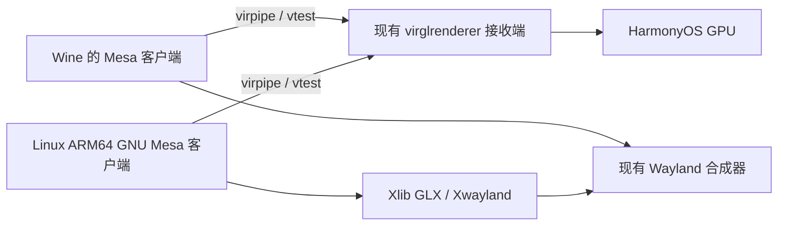

# Linux Steam 与 Wine 共用图形接收端

当前目标是复用既有 GraphicsBroker / vtest / virglrenderer 服务。Wine 和 Linux Steam 的 Mesa 分别按 musl/OHOS 与 GNU libc 编译，经过同一 vtest 协议连接同一个 Unix socket；不将两套 libc 的共享库混装进宿主。

接收端已经使用 `--no-fork --multi-clients`。GNU 子进程通过 NCP 参数接收宿主当前就绪的 socket，单独设置 `GALLIUM_DRIVER=virpipe` 与 `VTEST_SOCKET_NAME`。不重启接收端，不修改宿主或 Wine 的进程环境。接收端不可用时明确报告 `shared_vtest_receiver_unavailable`。

仅诊断配置 `client-launch.conf` 可设置 `mesaDriver=virpipe`；`softwareOpenGL=1` 保留 softpipe 对照。两种模式共用独立 GNU Mesa 库。外置库、测试程序、原版 Steam 与资源仍位于 Z 盘，HAP 不包含这些文件。

验证程序交替绘制 18 帧红、绿、蓝图案，分别检查 `glReadPixels` 与 X11 窗口像素。共享模式还要求 renderer 为 virgl，才报告 `sharedReceiverVerified=true`。此标志仅说明共享渲染和当前 X11 传图验证，不代表 Steam 启动、GPU 零拷贝、并发多应用或 Proton 已通过验收。

Xwayland 目前使用 SHM 软件输出到 Wayland，但禁用 X11 的 MIT-SHM 扩展；GNU Mesa 设置 `XLIB_NO_SHM=1`，避免调用系统禁止的 SysV IPC。两种 SHM 含义不同：Wayland 软件输出仍保留，X11 图像通过普通协议传送。当前方案涉及读回/拷贝，后续零拷贝需要独立验证，不能用 GPU renderer 名称推导为已实现。

Vulkan 可继续沿现有 Venus 接收能力评估，但 GNU Vulkan 客户端、WSI 与 DXVK/Proton 调用链需要另行接入和验收。共用接收端不会引入 CPU 指令转译。

本轮实机记录见 `CLIENT_PHASE_5.zh-CN.md` 和本机 `artifacts/steam-linux-arm64-client-20261019/tablet-steam-external-*.json`。

## 本轮实机结果

2026-10-19，USB 平板 `external-18`：renderer `virgl (Maleoon 910)`，OpenGL 2.1 Mesa 25.0.1，18 帧交替 RGB 的 `glReadPixels` 和 X11 窗口像素均正确。`glxPreflight.exitCode=0`、`sharedReceiverVerified=true`。

GNU 客户端所需修改为显式 SHA-1 Build ID，以及只应用在隔离源码副本上的 Xlib 呈现上下文补丁。接收端和 Wine 的 Mesa 产物没有为本次验证重编。先前已完成 softpipe OpenGL 3.3 对照，避免把软件回退误判为共享 GPU 成功。

原版 Steam 保持未修改；客户端登录、CEF 子进程、输入、Vulkan/Venus 和零拷贝并未因此自动验收。

## 24 位窗口与 visual 的兼容修正

external-25 的服务器诊断确定：Steam 请求 24 位窗口，但旧 Mesa Xlib GLX 的优先最深 visual 规则返回了不适用的 visual，创建失败。新增 `0002-xlib-prefer-compatible-screen-visual.patch` 只用于隔离 GNU Mesa 源码，优先匹配满足颜色深度和 visual 类约束的屏幕默认 visual。显式覆盖仍优先，无法满足请求时保留原搜索。这不是在 Xwayland 中忽略错误，也不修改游戏或 Wine Mesa。

external-26 与 external-27：BadMatch 不再出现，GLX 预检仍在 virgl (Maleoon 910) 上通过 18 帧回读。完整 Steam/CEF 界面和 Vulkan/Proton 仍需独立验收。
