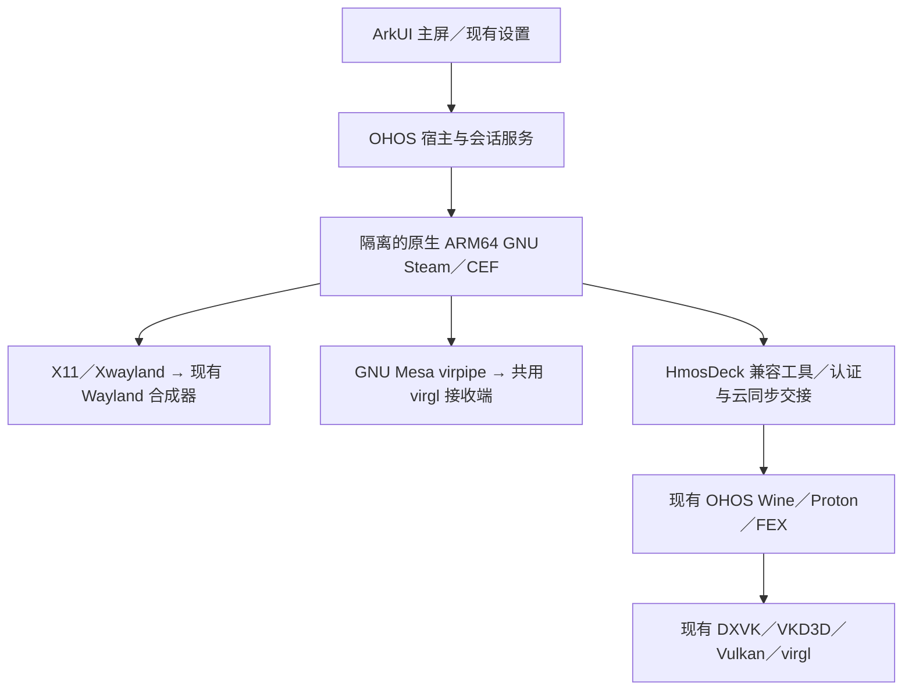

# Linux ARM64 Steam 依赖与交付清单

2026-10-20，`main_proton_steamarm64` 工作树。以实际外置 runtime 清单及 ELF `DT_NEEDED` 为依据，不把所有 Git 子模块都当作 Linux Steam 的新增依赖。

## 三层结构



GNU 与 OHOS 的 libc、动态库和图形对象分属两个 ABI。GNU Mesa 与 Wine 中的 Mesa 可以共用接收服务，不能直接把 GNU `.so` 链进 OHOS 主进程。Linux Steam 本身是原生 AArch64；FEX 负责需要它的 Windows x86/x64 游戏。

## Linux 客户端侧：外置 Z 盘

| 组件族 | 当前版本／来源 | 用途与实际边界 |
| --- | --- | --- |
| Valve Linux ARM64 Steam／CEF／网页资源 | 官方客户端固定包，`client-packages.lock.json`；Steam 原 ELF SHA-256 `bd059af3d99c8b9979a5218838cce9ff44bef4c5ccc0b399b333db0ae1b84a89` | 登录、授权、商店、库、下载、云同步；不是 Windows Steam |
| GNU glibc／loader | 2.38，仓库 `patches/glibc`，当前 manifest 锁定 9 个补丁 | TLS、线程、动态链接、spawn、外置执行映射及 fstat；配对更新 libc 和 loader |
| GCC 运行库 | Arm GNU Toolchain 13.3.Rel1 中 libstdc++／libgcc_s | GNU C++ ABI；与 OHOS libc++ 分开 |
| Wayland client／libffi | 1.22.0／3.4.6，source archive hash 已锁定 | Xwayland 连接现有宿主 Wayland；GNU 编译产物独立 |
| Xwayland | 24.1.3，带现有 OHOS 适配补丁 | rootful 私有 X11 显示；不是第二个 OHOS 桌面合成器 |
| X11／XCB 扩展及底层库 | Debian bookworm arm64；如 libX11 1.8.4、libxcb、Xau、Xdmcp、Xi、Xrandr、Xrender、Xfixes、Xcursor、Xtst、SM／ICE | CEF／VGUI 窗口、输入、RandR 等依赖；具体 Debian 版本和包 hash 见 lock |
| pixman／Xfont／freetype／fontenc／xcvt／xshmfence | Xwayland 依赖闭包 | X11 软件绘制、字体及同步；保留 XKB 数据与 Xlib locale，否则输入／文字可能失败 |
| GTK2／GLib／GIO／ATK／Pango／Cairo／HarfBuzz／Fontconfig | Debian arm64 运行库 | Steam/VGUI/CEF 的桌面与字体依赖；不表示启动了 GNOME |
| NSS／NSPR／GnuTLS／证书／加密依赖 | Debian arm64，含 NSS 显式动态模块 | TLS 与证书校验；NSS 的 `softokn/freebl/nssckbi` 通过名字 dlopen，不能只依赖 DT_NEEDED 裁剪 |
| DBus／udev／systemd／CUPS／Avahi／网络辅助库 | CEF 闭包中存在的运行库 | 有库不等于宿主运行对应 daemon；保留客户端的失败／回退语义 |
| ALSA／Pulse／OpenAL／PipeWire／音频编解码依赖 | Debian 与 Valve 包 | OHOS 播放走自有 ALSA PCM → AudioBroker；文件包含 Pulse/PipeWire 库不表示移植了其系统服务 |
| GNU Mesa GLX／virpipe | Mesa 25.0.1，`557fa3e781ea6e78fcff3ee759c25f60c3055064` | 共用 virgl 接收端；softpipe 可诊断。当前 CEF GPU 默认关闭，不能把 GLX 小程序通过当作 CEF 加速通过 |
| bash／ncurses tinfo／taskset／lsof | bash 5.2、util-linux 2.38.1、lsof 4.95.0 | Steam 脚本、进程与真实 socket 身份查询；lsof 有受限宿主查询补丁 |
| 自有 GNU 适配与桥 | `gnu_fixture`、`steam_bridge` | POSIX／IPC／路径、窗口状态、音频、手柄、游戏启动和 SteamAPI ABI 桥；不是第三方框架 |

外置数据为 `Z:\SteamLinuxARM64` 下的校验 release、独立 Linux client 数据与单一 library。当前交付改为：GNU 支持库压缩后随 HAP 的 rawfile 提供，Valve Steam ELF／CEF／界面从官方源下载；不复用 Windows Steam 目录。安装沿用 manifest、大小和 SHA-256 校验，写入完成后再切 active release，详见[组件交付与下载验证](COMPONENT_DOWNLOAD.zh-CN.md)。

本轮清单有 **253 个 ELF、746,517,464 字节（约 712 MiB）**，包括 Valve 辅助工具、同内容不同文件名和诊断工具，不是绝对最小启动闭包，也不是运行内存。外置导入清单共 307 项、约 818 MiB，另含压缩的数据、证书与声明文件；解压后的客户端缓存、下载游戏不在这个数字里。

## OHOS 宿主侧：复用现有子工程

| 子工程／平台 | 作用 | 对 Linux 主题移植的处理 |
| --- | --- | --- |
| HarmonyOS ArkUI／ArkTS、NDK、NAPI | 主 UI、窗口／Surface、输入、音频、沙箱、子进程 | 直接复用，不引入 Kotlin／Compose runtime |
| Wine／wine-valve 及工程的 Proton 适配 | Win32 HWND、任务栏、Windows 游戏和 SteamAPI PE 端 | 保持 OHOS 版本；无须换成 GNU Wine |
| FEX | 当前 x86/x64 游戏执行路径 | 不作为 ARM64 Steam 的翻译器 |
| Wayland／wayland-protocols／xkbcommon／xkeyboard-config | 现有合成器、协议和键盘 | 两个 ABI 分别构建，统一输入／焦点与合成器 |
| Mesa／virglrenderer／epoxy／drm | OHOS GL／共享接收端 | Mesa gitlink 保持上述固定提交；不混用 GNU 驱动对象 |
| dxvk／dxvk-modern／vkd3d-proton | 游戏 D3D → Vulkan，按配置与设备能力选择 | 现有原生 Vulkan 驱动路径，不搬 Android KGSL／Turnip |
| freetype／libxml2／GnuTLS 链／GLib／GStreamer 等 | 现有 Wine 的字体、TLS、媒体等能力 | 沿用已有构建与许可清单，不因新 UI 全部重编 |
| Box64 | 仓库保留的另一种执行后端 | 当前 Linux ARM64 Steam 基线无新增依赖；不与 FEX 同时嵌套使用 |

构建使用 GNU ARM64 交叉编译器、LLVM MinGW（自有 PE 宿主／接口）、OHOS SDK、CMake/Ninja、Python、Node/hvigor；Xvfb 是主机回归工具。这些不需要安装到设备。

## 尚未成为当前依赖的项目

DroidDeck 的 Kotlin/Compose、Android Service/HOME、gamescope、proot／完整 rootfs、GNU Proton、Android Turnip/KGSL 和 GNU Vulkan ICD，均不是移植主界面的前置条件。上游机制值得借鉴，Android 系统组件不直接搬到 OHOS。未来若支持 GNU 原生 Vulkan 游戏，需另外实现 Vulkan ABI／WSI 与驱动资源互通，不能用当前 Windows DXVK 路径的通过结果替代。

静态审计发现可选工具仍有不在当前清单中的 DT_NEEDED：`gldriverquery` 的 SDL2、旧 libavutil 的 VDPAU、Valve `libs/libcurl` 的 OpenSSL3/libssh2。它们不证明当前会话实际加载了这些库；后续启用相关工具时补齐并单独验收。当前主题开发不借机导入整个发行版。GSettings schema、服务端 daemon 和设备权限也不能从 `.so` 存在推断已实现。

## 可复查的来源与维护

`runtime-dependencies.lock.json` 保存每个 ELF 的大小、SHA-256、SONAME、DT_NEEDED、RPATH/RUNPATH，以及可获取的源包版本和 hash。清单可从下列脚本重建，不执行外来 ELF：

```sh
python3 scripts/audit_linux_steam_runtime.py --runtime /path/to/runtime \
  --package-lock /path/to/debian-client.lock.json \
  --output docs/linux-steam/runtime-dependencies.lock.json
```

这是文件供给审计，不能模拟所有 loader 搜索顺序或 dlopen 路径。完整构建仍以 runtime 自身 manifest、仓库各 `build_linux_steam_*.py`、包 lock 和补丁 hash 为准。第三方版权、许可证与需要交付的对应源码应随具体模块保存；Valve 专有资源继续外置，不通过复制进 HAP 来解决部署。产品化裁剪时先把仅测试程序单列，再做实际加载观测，避免按库名删除 NSS／字体等动态依赖。

## 联网安装与后续更新

产品化按 [经典／Deck 双界面设计](DECK_PRODUCT_DESIGN.zh-CN.md) 提供统一组件页。GNU 支持库随 HAP rawfile 提供；Valve 客户端可从官方源获取，或选择与当前应用配套的本地包导入。整包与文件分别校验，完成后再激活版本。已安装时支持配套版本更新／修复，重置仅清组件及缓存并保留游戏库、账号与存档。当前实机与自动化验证边界见[组件安装与维护验证](COMPONENT_DOWNLOAD.zh-CN.md)，不把旧 external-import 的启动结果当作全量在线首装验收。
