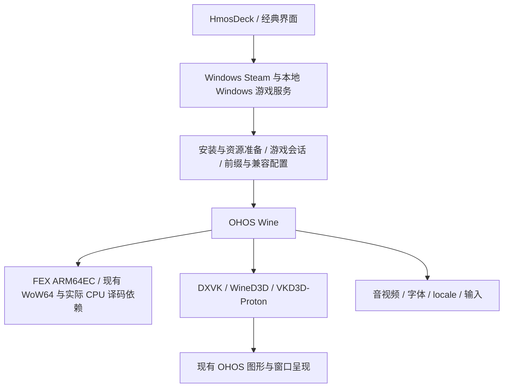

# VPP 2.0.0：收敛到 OHOS Wine 与 Windows Steam

状态：实施中。2026-11-12 用户批准推进开发。首批接入新分支 CI、修复 final 标签版本校验、应用升级为 2.0.0 / 2000000，并建立独立 Windows Steam 回归入口；完整构建及真机基线仍待确认。原计划制定时只提交文档，以下实施顺序与验收门槛继续适用。

## 1. 冻结点和产品边界

- 最后一个保留 Linux Steam 的源码快照：`rc-1.5.8-final` → `67ea17f72d0b8a4d25eedcd75d3a7b837cd3ffbf`，应用 `1.5.8 / 1005080`。
- 后续开发分支：`feature/v2-ohos-wine-winsteam`，从上述标签建立；旧标签不移动，不重写历史。
- 2.0.0 保留 OHOS Wine、Windows Steam、HmosDeck 和经典界面。移除产品中的 Linux Steam、Linux 原生游戏与 GNU Proton/WineD3D 后端；完整 Linux 用户态支持由独立产品 HSL 承担。
- 不再投入 VPP 的 Linux rootfs、Linux Steam 性能、Linux 游戏 FEX/GL/Vulkan 适配和原生 Linux 退出问题。对 OHOS Wine 有价值的公共修复继续保留。
- 2.0.0 是产品收敛，不是删除所有名称含 Linux、Proton、FEX 或 Valve 的文件。构建宿主仍可为 Linux；OHOS Wine 仍会吸收 Proton 与 FEX 修复。
- 保持 bundle `com.vintage.pomelopro` 和既有发布签名身份。实施时将 versionName 改为 `2.0.0`，按现有编码规范核对 versionCode（预期 `2000000`，必须大于 `1005080`）；本次不改。
- 不改变 GitHub 默认分支，不将整套 HSL 运行库变成 VPP 的隐式依赖。

冻结事实、已知问题和包校验值见 [1.5.8 收口记录](../releases/rc-1.5.8-final.zh-CN.md)。标签表示保留最后 Linux 版本，不表示全部游戏与性能验收完成。

## 2. 先保住已经有效的 Windows Steam 基线

| 既有能力 | 对应提交与约束 | 2.0 处理 |
| --- | --- | --- |
| 冷热启动、旧卡片迁移 | `425a4088`：受控 `steam.exe`，旧 batch 卡迁移，默认打开库页 | 保留统一入口与会话所有权，禁止重回任意脚本启动 |
| 库低性能设置 | 每账号一次性原子修改 `LibraryLowPerfMode`，客户端及游戏停止后操作 | 保留用户后续选择及其他配置 |
| CM 目录等待 | `6b967cee`：仅有缓存 WebSocket CM 时两个目录请求由 60 秒缩至 5 秒；无缓存仍 60 秒 | 保留缓存回退、实际版本校验和原子 helper 升级，不修改磁盘原始 `steamclient.dll` |
| CEF 可操作性 | `8da32e9c`：未明确设置者默认软件 CEF，保留显式 GPU/软件偏好 | 客户端绘制设置与游戏 DXVK/WineD3D 独立 |
| 输入与窗口 | 独立输入空间、物理/虚拟鼠标坐标、代次、焦点、沉浸、图形资源释放 | 保留对 OHOS Wine/经典界面有效的实现和回归 |
| 1.5.7 基础功能 | 会员与购买、字体导入、离线导入、容器、用户配置与存档 | 按真实入口回归，不能随 Linux 服务一并删除 |

历史 Mini 的 Windows Steam 自报启动为 43.17/37.61 秒，旧版本为 96.12/93.83 秒，不含宿主首次准备；暖菜单约 1.266 秒、下载页约 3 秒。这是旧包、旧网络条件的短测，不是当前 67 包的 Windows Steam 实测或 2.0 性能承诺。首次详情仍可需 6–10 秒以上，空闲约 1.1–1.3 核，整体卡顿与降耗尚未解决。

新版 helper 尚缺完整下载、`-applaunch`、游戏退出重开、前后台恢复回归。**第一批实现先补这些 Windows 产品路径基线，再移除 Linux。**

## 3. 目标运行结构

Windows Steam 是客户端进程树，游戏是独立会话；它们共享的 Wine/图形服务按真实生命周期管理。关闭某个游戏不能终止 Steam 或其他游戏。运行中、继续、取消、正常关闭、强制结束继续使用可靠的进程身份、请求代次和窗口归属；窗口消失不等于进程退出。

本地 Windows EXE/已有容器仍可启动，不能因聚焦 WinSteam 把 VPP 变成只会打开 Steam 的外壳。兼容性设置保留显式选择，不自动把 GPU 或译码正确性换成速度。

## 4. 源码拆除与保留清单

以下是当前源码的调查入口，实施前以当时 HEAD 再核实引用关系。

| 区域 | 发现的耦合 | 实施动作与验收 |
| --- | --- | --- |
| `components/hmosdeck/DeckHome.ets` | 直接持有 Linux Action/Snapshot、安装/库/封面/会话服务和 `launchUsesLinux` | 先抽中性游戏模型与 Windows 库适配，保留卡片、手柄导航、运行中和全部会话操作，再删 Linux 订阅和分支 |
| `model/DeckSteamLibrary.ets` | `DeckSteamGame extends LinuxSteamGame`，双后端合并及 AppID 校验 | 去继承，AppID/封面/状态变为独立模型；保留 Windows 安装库、排序和缓存语义 |
| `service/SteamClientService.ets` | 双客户端选择、Linux Action、互斥与安装阻塞 | 收敛 Windows 客户端；复用 `SteamLocalService.clientCard()` → `AppSessionService.launch()`，保留单次启动/导入互斥 |
| `pages/Index.ets` | 初始化 Linux session、未安装与 Resources 跳 `pages/LinuxSteam` | 未安装、下载/导入、资源管理、错误恢复统一指向 Windows Steam，避免只隐藏按钮后留下死路 |
| `pages/LinuxSteam.ets`、`LinuxSteamPanel.ets`、`ProtonRuntimePanel.ets` | Linux 专用页面/组件 | 去路由、去资源注册、去菜单、空态与帮助文案；完成替代后删除生产文件 |
| `LinuxSteam*`、`LinuxGnuProton*` 等服务 | 安装/下载、库读取、GNU backend、Cloud 桥、Linux 启动和会话 | 按调用图拆除；已归属于 Wine/Windows 的库路径、窗口和进程通用能力先迁出 |
| NAPI/broker/NCP | Linux-native 协议、GNU 执行、Linux 控制分支 | 移除 `HMOSDECK-NATIVE/1`、GNU 专用执行与导出；保留 Windows 协议、身份鉴别、会话控制和维护租约 |
| NativeWindow/carrier | 独立 Linux host 与共用 compositor/输入/沉浸逻辑 | 删除 Linux 产品入口，保留 OHOS Wine 所需承载、NativeBuffer/FD/fence/代次管理，禁止新增 CPU 画面读回 |
| `entry/src/main/cpp/linux_steam/` | 有共享探针被非 Linux 功能调用 | `CMakeLists.txt` 的 `direct_vulkan_probe` 直接引用 `linux_steam/native_buffer_probe.cpp`；先迁共享实现、改引用并编译，再删除专用部分 |
| rawfile `linux-steam` / `linux-proton` | GNU ARM64 Steam、基础用户态、GNU Proton 与 FEX 原生路线载荷 | 列最终包成员与实际消费者，删专用项及下载锁；共享文件迁移并校验字节身份 |
| 脚本、Make/CMake、CI | GNU 生产校验、组件构建、离线包、发布缓存和诊断 | 同批更新生产依赖图；保留 Windows/Wine 测试，Linux 测试按退役移除，不能通过整体关闭测试绕过失败 |
| 文档与历史资料 | 旧路线说明会误导新用户 | 活跃文档更新为 WinSteam；历史实现由 Git 标签保存，不复制大型 archive 目录 |

当前 rawfile 的 `linux-proton` 约 290 MiB、`linux-steam` 约 82 MiB，只是目录原始大小；共享拆分与压缩前，不能承诺安装包减少 372 MiB。

### 4.1 必须保留，不能按名字误删

- `thirdparty/wine-valve`：Makefile 目前的 OHOS Wine 实际源码入口，保留并改善补丁治理。
- Makefile 的 `fex` / `libarm64ecfex.dll`：OHOS Wine ARM64EC 译码依赖；保留匹配 ABI 和有效 SMC/信号/guest protection 等公共修复。只移除 Linux 原生游戏的 FEX 启动器、GNU 用户态/thunk 组合等专用部署。
- 现有 Wine32/64、WoW64、Box64：按最终 Wine 依赖闭包决定保留，不凭“双译码器”印象删减。
- DXVK legacy/modern、ARM64X/x86 DLL、WineD3D、VKD3D-Proton、Mesa/Venus/VirGL、Wayland/Xwayland 中仍被 OHOS Wine 使用的部分；媒体、GStreamer、字体、locale、IME、剪贴板和输入设备支持。
- HostGameSession/HostWindowTasks 的通用身份、窗口代次和事件线程关闭修复；提取 OHOS Wine 需要的代码，不带回 Linux broker 分支。
- Windows Steam 安装/导入、CM 目录缓存、software CEF、`vpsteamtrust32.dll` 与 runtime32 helper。`prepare_windows_steam_runtime.py` → `steam_legacy_zstd/vpsteam_runtime32.c` 的源码/工具链/hash/PE i386 与时间戳校验合同保留。
- 会员权限、正式/测试购买兼容、提醒、字体和现有游戏/容器/存档功能。支付测试不代替真实交易验收。

### 4.2 删除的完成定义

不能只加开关或不显示入口。最终生产包、安装下载清单、离线包、NAPI 导出、路由与运行路径中均不再携带或准备 Linux Steam/GNU Proton；全新运行不创建 Linux runtime、不启动 GNU/FEX Linux service、不访问退役下载地址。历史文档、许可证文字和构建宿主中必要的 Linux 字样不作为违规残留。

## 5. 用户数据与升级迁移

1. 同签名覆盖升级，保留 Windows Steam 前缀、客户端登录状态、游戏库、容器、存档、用户资料与兼容设置。需要验证不同安装位置、私有 C 盘、公共目录和别名/授权目录。
2. 第一次 2.0 启动检测旧 Linux 安装，明确告知路线停止支持、现存文件位置及可回收组件大小；不把用户库自动当缓存。
3. 可重下载的 Linux 专用受管组件只有在用户明确选择清理后才删除。按实际组件 manifest、根目录和所有权核实，禁止删除整个 `SteamLinuxARM64` 或整个 Download；其中可能有游戏与存档。
4. 不自动合并两边前缀、搬运存档或覆盖 Steam Cloud 冲突。Linux-only 版游戏保留文件并标明 2.0 不支持；Windows 版本下载/更新由 Windows Steam 管理，不能假设 Linux 文件可直接充当 Windows depot。
5. 老快捷方式、卡片、deep link 和离线 Linux 包给明确退役提示及可行替代，不能静默改到另一游戏版本。保留第三方用户内容。
6. 迁移只在对应会话退出后执行；原子写入小型配置、记录 schema 与完成阶段，中断能重试，完成后不反复覆盖用户后续偏好。原件需要回退时仅保留一份必要配置备份。
7. 回退路径引用 `rc-1.5.8-final` 和保留的一个可安装包；不假设系统允许跨 versionCode 降级，不以卸载后丢数据作为默认回退。实施前测试可恢复的数据导出，只有用户决定时才执行应用降级/数据删除。
8. HSL 是独立选择，不自动安装、不共享私有凭据、不自动导入用户游戏。

## 6. 让上游修复容易同步

### 6.1 沿用现有构建和来源合同

复用 `docs/graphics/graphics-stack.lock.yaml`、组件构建脚本、`scripts/ci_preflight.py`、`make test-game-runtime` 和现有来源校验，不另造一套平行编译系统。Linux 专用锁退役时，把仍有效的 OHOS 输入纳入现有图形/Wine 来源合同；清单格式以一个权威来源为准，避免同一版本在多处手改。

每个组件需要可追溯：源仓库、上游 commit、产品 fork commit、递归子模块、工具链/SDK/容器 digest、配置/ABI、按顺序的 patch hash、最终载荷 hash、许可证与构建收据。清单变化使相应缓存失效，缺来源时构建失败，不能继续打入旧 DLL/so。

### 6.2 补丁分层

| 层 | 内容 | 同步原则 |
| --- | --- | --- |
| 平台适配 | OHOS libc/系统接口、NativeBuffer、NAPI/窗口、进程/内存语义 | 尽量缩小与上游的差异，边界明确，不埋游戏名特例 |
| 公共修复 | Wine/Proton/FEX/DXVK 的通用正确性修复 | 优先追踪上游提交，可独立回归；上游已合入则删重复 patch |
| 产品策略 | WinSteam 启动、前缀/兼容配置、资源安装/升级、HmosDeck | 留在 VPP 自己的服务和配置层，减少改 vendor 源码 |
| 兼容配置 | 某游戏必要的 dll override、参数和图形选择 | 尽可能数据化、可撤销；不能掩盖公共 ABI 错误 |
| 诊断 | 有界日志/探针/重放/实验 | 默认关闭，说明构建身份；未经独立审查不混入生产基线 |

每个 patch 至少记录来源 URL/commit、作者/许可证、目的、前置 patch、适用版本、上游状态、主机/真机回归和移除条件。保持原作者信息，拆开无关改动。冲突解决记录保留了哪些语义，禁止大段采用一边而遗失既有 OHOS 修复。

### 6.3 各来源的同步方式

- WineHQ/Valve Proton/GE：对 ntdll/kernelbase、同步、媒体、音频、网络、输入等按依赖组选择修复；DLL/loader/Mono/ICU 等按配对合同升级，不从其他包随意拷贝一个二进制。引用 Proton 不意味着恢复 Linux Proton 脚本、pressure-vessel 或 Linux Steam。
- FEX：明确区分 OHOS ARM64EC 目标与 Linux GNU core。引入 SMC、信号、time64、线程/地址空间等公共修复时，覆盖当前 ABI、翻译测试和动态代码；不降低 SMC/同步正确性换性能。
- DXVK/VKD3D-Proton/Mesa/VirGL：保持 shader、扩展协商、内存/图像/FD/fence 生命周期与 CPU 译码匹配；升级先做一组件小批，再验证整组载荷，保留 VPP 已有显存释放修复。
- HSL/WineHua/其他适配：可以吸收平台与公共修复；先检查是否依赖完整 rootfs、GNU ABI 或 HSL 会话。必要语义适配到 OHOS，不能整包复制后重引入 Linux 产品线。

### 6.4 一次上游同步的交付流程

1. 固定候选 upstream commit，列新增/已上游化/冲突 patch 与预期收益，不只写“升级最新”。
2. 在固定隔离/增量目录应用；对公共错误先有能复现语义的定向回归，避免只校验源码字符串。
3. 从所声明输入构建需要变化的组件；验证 ELF/PE 架构、导出/依赖、ABI、源码补丁身份及最终 stripped 成员，禁止只刷新 manifest 给旧二进制改名。
4. 运行相应定向测试和完整必要回归，Mini 用普通 WinSteam/本地产品入口验证；记录真实退出与未知状态。
5. 子模块新对象必须先推到可访问 remote，再提交父 gitlink 与 lock；补丁模式则把 patch、顺序、hash 和应用脚本一并提交。不得留下只有本机有的对象或未管理 dirty 修改。
6. CI 干净检出重建/校验通过后合入，保留一组有效回退输入。失败回退一个组件组，不重写历史标签、不临时混用旧载荷。

## 7. 分阶段实施与提交

每阶段是可编译、可回滚的小批；出现 Windows 回归先修复当前批，不带病继续大规模删除。

| 阶段 | 内容及主要文件 | 进入下一阶段的门槛 |
| --- | --- | --- |
| P0：基线与 CI | 新分支接入 branch/PR CI；修复 RC final 后缀解析并保留版本/commit拒绝校验；按规范改 2.0.0；盘点共享依赖与本地 overlay；补新版 Windows helper 完整生命周期基线 | 干净检出 HAP 成功；Windows 安装/启动/下载/游戏/退出/恢复结果可追溯；未验证项明确记录 |
| P1：UI 与服务解耦 | DeckSteamLibrary/DeckHome/SteamClientService/Index；实现 Windows 资源/安装/导入路径；移除 Linux 选择 UI | HmosDeck/经典界面都能完整使用 Windows Steam；新装空态、手机布局和旧快捷方式无死路；提交 `refactor(deck)`/`feat(steam)` |
| P2：运行后端与共享提取 | 迁移共享 probe/session/window 代码；移除 Linux/GNU 服务、NAPI/broker/NCP 和专用协议 | OHOS Wine 游戏关闭/取消/强退不影响 Steam；无 GNU 服务启动；全部必要 native 与 ArkTS 回归通过 |
| P3：载荷、下载与构建 | rawfile/Make/CMake/scripts/locks/CI/离线包去 Linux；保留 Wine/FEX ARM64EC/图形依赖；同步许可证 | 干净构建、最终 HAP/APP 成员与依赖闭包检查通过；不会联网恢复已删除组件；WinSteam ZIP 与字体可导入 |
| P4：升级与补丁治理 | 旧安装提示、显式组件清理、重试/中断、配置迁移；落实上游来源/有序 patch/缓存规则 | 从 1.5.8 覆盖升级保留用户数据；删除只影响获准组件；新上游 patch 能独立构建和追溯 |
| P5：2.0 候选验收 | 干净全新构建、Mini 新装与升级、WinSteam/本地游戏矩阵、同场景性能、交付包及来源 | 全部阻断项关闭；每项对应 commit/包/hash/设备与结果；明确残余限制后再打新候选标签 |

P0 可在分支保留临时 Linux 实现作为拆分过渡，但正式 2.0 交付必须满足第 4.2 节，无长期隐藏 Linux 后门。各批版本/CI/测试变化写清，禁止提交到新分支却因 workflow 分支过滤而没跑 CI。

## 8. Windows 路线验收矩阵

| 范围 | 必测场景 | 证据要求 |
| --- | --- | --- |
| 安装与升级 | 全新安装、1.5.8 同签名覆盖、权限延迟、组件缺失/过期/损坏、下载中断重试 | 包身份、组件组版本、源 hash；不能靠旧设备缓存过关 |
| WinSteam | 正常产品入口扫码/缓存登录、CM 有/无缓存、客户端升级、软件/GPU 显式设置、菜单/详情/下载 | 实际参数/helper身份与成功/失败时间，不修改原始 Steam DLL |
| 游戏生命周期 | 普通库 Play 与 `-applaunch`；准备/取消；正常退出/强退；退出重开；Steam 与游戏后台恢复 | AppID、进程身份、窗口代次、真实退出码；未知保留未知，255 不计正常退出 |
| 代表游戏 | 仙剑1/4、星露谷、Banana 的 Windows 版本；尖塔2 只验本账号可用的 Windows 版本 | 当前版本/平台/译码/图形路径；Linux 版本历史成绩不替代 Windows 验收 |
| 音视频与输入 | 仙剑片头/对话、现有媒体样例、字体/中文/IME、触屏/虚拟与物理鼠标/键盘/手柄 | 有声有图、坐标及焦点；不以 dummy 音频或只到菜单代表完整游玩 |
| 路径与手机 | 私有/公共库、空格/中文/别名授权路径、权限撤销、窄屏/横竖屏/安全区/缩放 | 不硬编码手机不可访问的平板绝对路径；引用当前67私有/别名修复 |
| 数据安全 | 存档/Steam Cloud 冲突、Linux-only 旧库、旧 deep link、组件清理与中断恢复 | 保留用户文件；不自动选择 Cloud 覆盖、不假设可共享两个平台前缀 |
| 原有业务 | 会员购买开关刷新、签名/环境兼容、字体导入、Windows Steam ZIP、容器/配置 | 主机测试与真机结果分开；会员不凭安装测试签名直接授永久 VIP |
| 最终包 | unsigned HAP、按真实发布签名要求的 APP、资源/许可证/清单与来源报告 | 用同一 commit/组件组生成；release/internaltesting 不能冒称 AppGallery 已上架 |

## 9. 性能工作顺序

先确认 Windows Steam 生命周期可靠，再采有效线程/绘制热点。保持 CM 缓存限时、低性能库和默认软件 CEF 的现有收益，继续调查详情加载、CEF 菜单绘制及空闲 CPU。需要有效 guest 栈/CPU 证据；历史采样长期停在 syscall trampoline 或跨位数查询失败，不能作为热点结论。

固定同机、同客户端/游戏 Windows 版本、同场景画质与图形后端，至少三轮交替对比 1.5.8 Windows 基线与候选。分别记录运行库首次准备、客户端冷/热启动、登录/库可操作、游戏首帧、帧时间、内存、退出耗时及残留。记录温度/网络/缓存差异；平台不同的游戏不可当同版本 A/B。不预设必须达到的百分比。

不通过关闭证书验证、写死单一 CM、篡改原始 Steam DLL、降低 SMC/同步或增加游戏画面 CPU 读回制造“提速”。

## 10. CI、可还原构建与存储

已确认的发布脚本缺口：`verify_ci_release.py` 以完整字符串比较 `rc-` + versionName，拒绝 `rc-1.5.8-final`。P0 支持明确的 `-final` 后缀，覆盖普通 RC/final 正例及错误版本、额外后缀、错误 commit 负例；不能放开任意标签或绕过来源校验。历史标签不移动，标签CI失败事实保留；对冻结源码的重新发布需要审查独立发布验证器的来源和源码身份。

- P0 起为新开发分支和目标 PR 接通现有 CI；保留会员、OHOS native/ArkTS、Wine/Windows runtime、来源与最终包检查。GNU job 在专用依赖退役后才删除，用 OHOS 必需闭包校验补齐对应责任。
- 本地/CI 同一 Make 与脚本入口。输入键包含 source/ordered patches/toolchain image digest/SDK/ABI/config；缓存命中也校验载荷身份，错配立即停止。
- 明确哪部分 CI 真正源码构建，哪部分验证固定发布载荷。最终至少从全新检出执行应用构建，并按已声明入口重建变更组件；不把“校验预编译 ZIP”写成“所有库从源码重建”。
- 本地开发子模块的已管理 overlay 与实验修改分开报告；构建以来源锁和最终 payload 为准。冻结时发现的 VirGL 本地 GPU flight/phone replay 诊断不属于生产快照，保持原文件但不混入发布。
- 对每个候选记录 commit、gitlinks、patch hashes、最终 HAP/APP 及离线包 hashes、依赖来源、测试状态。签名材料外置，不在 Git 或 CI 日志存凭据。
- 固定任务目录，复用增量树和依赖；调试签名 HAP 只留当前及一个回退包。正式交付与用户数据不纳入测试清理。单日志 <=32 MiB、有界采集；按工作区规则清理可再生副本。

## 11. 风险与回退

最大风险是 HmosDeck 和窗口/进程公共层与 Linux 命名耦合：先迁公共能力再删，而非删目录后逐个补编译错误。第二风险是误删 FEX ARM64EC、Valve Wine、共享图形和 Windows helper 的依赖。第三风险是升级把用户 Linux 库误当 runtime 删除。上述都有独立门槛与负向测试。

每批保留可独立 revert 的提交，不靠重置共享工作树回退。新组件失败用上一组完整输入/载荷回退；不拼新旧 DLL。用户数据迁移与可回下载组件清理分开，正式删除用户数据不列为自动任务。

初始规划交付保存于 `f990b176`，只包含标签、新分支、来源/收口记录与本计划。2026-11-12 已获准从 P0 开始实施；Linux 删除尚未开始。各阶段构建与真机结果以实施记录为准，不把路线调整视为遗留问题已经修复。
